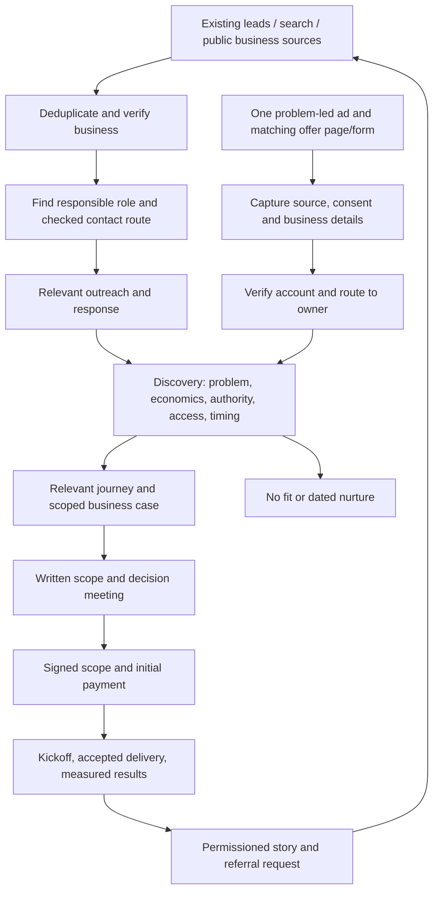

# Reachwise: complete business, delivery and customer acquisition playbook

Consolidated 2 November 2026.

This single document combines the full materials behind the last two responses, covering both sets of annotations. It includes the research, standalone offers, delivery templates, production scenarios, acquisition process, sales practice cases and advertising plan. Sources and editable templates are retained throughout.

## Current decisions

- Begin with Indian ecommerce businesses across product categories; previous experience does not limit the businesses Reachwise can serve.
- Your delivery capability is taken as given. Sell separately scoped solutions and use relevant actual work to establish trust.
- The earlier multi-service launch packages are superseded. The creative sprint remains a proposed premium offer at INR 33,000, with its strategic scope made explicit; other quote ranges remain working hypotheses.
- Ads and researched outreach may run in parallel. Five manually acquired customers and a completed 100-account list are not prerequisites for advertising. Prepare the offer, evidence, enquiry handling, tracking, capacity and a funded, bounded test.
- Published customer cases remain attributed to their publishers. Prospect practice dialogue is original training material; source limitations are stated.

## Annotation coverage

| Response set | Coverage in this document |
|---|---|
| First set: 1, 2 and 3 | Recurring problems, decision-maker access, qualification metrics and economics: Parts 1 and 5 |
| First set: 4, 5 and 6 | Service/buyer ranking, creative price comparison and standalone offers: Parts 1 and 2 |
| First set: 7 and 9 | Clear offer presentation, delivery milestones, templates and complete scenarios: Parts 2, 3 and 4 |
| First set: 8 | Excluded as requested |
| Second set: 1 | Repeatable process to 50-100 checked businesses and onward to customers: Part 5 |
| Second set: 2 | Six prospect-conversation study cases, source guide and practice scorecard: Part 6 |
| Second set: 3 | Corrected ads timing, preparation, economics and experiment decisions: Part 7 |

## Contents

1. [Part 1: Market, recurring problems, buyers and economics](#part-1)
2. [Part 2: Standalone offers and competitor pricing](#part-2)
3. [Part 3: Client story and delivery templates](#part-3)
4. [Part 4: Real-world delivery scenarios](#part-4)
5. [Part 5: Repeatable customer acquisition process](#part-5)
6. [Part 6: Prospect conversation study cases](#part-6)
7. [Part 7: Ads and prelaunch validation](#part-7)

For execution, review Parts 1-2, prepare the relevant materials in Parts 3-4, and run Parts 5 and 7 in parallel while practising with Part 6. Part 7 is the controlling guidance on when to advertise.

---

## Part 1: Market, recurring problems, buyers and economics

Your ability to deliver is taken as given. Ecommerce is the initial sector across categories; your previous categories do not limit this business. The immediate offer architecture is a catalogue of separately purchasable solutions. The previously proposed multi-service packages are withdrawn from this revision.

The next commercial question is which expensive, recurring problem a reachable customer will pay Reachwise to own. This document supplies a research-backed shortlist and a method for establishing that customer-specific answer.

### 1. What recurring problem should we look for?

The strongest provisional umbrella is **important ecommerce work crosses several tools and people, but nobody reliably owns the complete outcome**. That is a positioning hypothesis, not a claim about every Indian founder. The individual sellable problem must be more concrete.

| Problem to investigate | What repeats | Who feels it | Evidence that the problem exists | What would establish it at a prospect |
|---|---|---|---|---|
| Failed deliveries are not resolved before the courier deadline | NDR event → customer response → courier instruction → final status | Logistics/operations head | Kapiva has a published LimeChat/ClickPost NDR implementation | Shipment-level history showing eligible exceptions, elapsed time, unresolved cases and final outcomes |
| Customers need an answer before completing checkout | Product objection, delivery question, payment difficulty | Ecommerce/retention head | P-Tal has a published conversational checkout recovery case | Actual conversation reasons, eligible abandoned checkouts and subsequent settled orders |
| Support staff repeatedly reconstruct order context | Status, split shipment, cancellation, refund and escalation | CX/support head | Man Matters has a published support automation case | Ticket reasons, handling time, reopened tickets and manual system lookups |
| Growth and finance work from conflicting numbers | Sales, refunds, delivery losses, ad spend and settlement reconciliation | Ecommerce head, finance head, founder | Ekster has a published reporting automation case | Reports that disagree, time spent resolving them, and decisions delayed |
| Feedback arrives but does not produce corrective work | Complaint → owner → remedy → confirmation → cause analysis | CX head, operations head | Nobero has a published feedback/CSAT case | Repeated complaint themes, unresolved actions and reopened issues |
| Creative production cannot keep up with a genuine testing plan | Brief → approval → variants → launch → learnings | Performance marketer/marketing head | Public competitors sell creative production; that alone does not establish a shortage at a prospect | Creative backlog, launch delays, production hours and unused approved assets |
| Returning customers are contacted at the wrong time | Replenishment, complementary purchase, reactivation | Retention/CRM head | Plausible service hypothesis requiring prospect validation in this pack | Customer cohorts, purchase intervals, eligible reachable audience, existing journey overlap |

Sources: [Kapiva NDR](https://www.limechat.ai/case-study/kapivas-journey-to-reducing-rto-by-10-with-limechat-clickpost-integration), [P-Tal](https://www.limechat.ai/case-study/how-p-tal-achieved-revenue-growth-with-limechat-x-webengage), [Man Matters](https://www.limechat.ai/case-study/man-matters-improved-its-csat-scores-by-automating-70-of-customer-queries), [Ekster](https://www.triplewhale.com/case-studies/ekster), [Nobero](https://www.limechat.ai/case-study/revolutionizing-agent-productivity-and-customer-satisfaction-with-ai). These are vendor-published examples, not a representative survey or Reachwise results. Ekster is an international example; it supports workflow plausibility, not Indian willingness to pay.

#### Initial research priority

Investigate **NDR resolution and operational reporting first**, then checkout conversations and support. NDR has a comparatively concrete event and financial outcome. Reporting can reach a more senior buyer and connect several decisions, but its value is harder to establish from time savings alone. This is a prioritisation judgment, not measured market demand. Keep creative as a separately qualified purchase, not an obligatory entry service.

Do not automatically build an alternative to an installed tool. First establish whether its existing capabilities are configured and used. Reachwise's work may be implementation, integration, operating ownership or a genuinely missing function. If the current provider can solve the whole problem adequately at lower total cost, there is no compelling implementation sale.

#### A practical problem-validation sprint

Use an initial set of approximately 12 conversations across ecommerce companies with different operating models: high COD, predominantly prepaid, repeat-purchase, and high-consideration purchases. These are operating characteristics, not product-category restrictions. Twelve is a manageable learning batch, not a statistically representative sample.

Ask for the last real occurrence rather than whether the person likes an idea:

1. Walk through the last failed delivery/reporting discrepancy/support escalation. What happened in each tool?
2. How often did this occur in the last complete month? Which export or queue records it?
3. Who noticed, who acted, and who was expected to act?
4. What did the current software already do? Where did the process still fail?
5. What did the failure cost, and what is merely assumed to have been lost?
6. What have you tried? Why did it remain unresolved: low priority, unclear ownership, lack of time, poor economics, or poor previous delivery?
7. Who can authorise a change and who can provide the required access?
8. What would make this worth paying to fix this quarter?

Record the answers in the problem card in Part 3. A working threshold for advancing a solution is: the same mechanism appears in at least three independent accounts; two can provide evidence; one is willing to discuss a bounded paid scope with its budget owner. This is a decision rule for Reachwise, not proof of market size. A payment is stronger evidence than agreement on a call.

Your India-specific ownership hypothesis becomes testable here. Record separately: **knows tools exist; knows desired outcome; has budget; has an accountable owner; has attempted implementation; wants execution outsourced**. Someone who knows tools exist but assigns low value to the problem is a weak prospect. Someone who has a costly recurring failure and wants a responsible operator is a stronger one. Nationality alone does not establish this buying behaviour.

### 2. How to reach decision-makers

Map three roles per account: the **user** who encounters the problem, the **champion** who will help change the process, and the **economic buyer** who can approve the purchase. A founder can occupy all three in a small company. A departmental head may have budget authority in a larger one.

| Solution | Best initial operational contact | Likely budget owner | Other person needed before scoping |
|---|---|---|---|
| Creative sprint | Performance marketing manager, brand manager | Marketing head/founder | Person approving claims and creative |
| Checkout recovery | Retention/CRM or ecommerce manager | Ecommerce/growth head | CX lead and store administrator |
| NDR resolution | Logistics manager, operations lead | Head of operations/COO/founder | Courier/aggregator owner |
| Support assistant | CX/support manager | CX head/COO | Policy owner and store administrator |
| Operational reporting | Ecommerce analyst, finance/ops manager | Ecommerce head, finance head, COO/founder | Owners of sales, costs and settlements |
| Retention/loyalty | Retention/CRM manager | Marketing/ecommerce head | Margin and offer approver |
| Workflow integration | Process owner | Department head/COO | Systems administrator |
| Voice agent | CX, inside sales or logistics lead | Relevant function head | Telephony owner and escalation team |

#### Account-to-person research sequence

1. **Verify the business.** Match store domain, brand and legal/trading identity using its own website. For Maps or scraped records, require matching domain or other strong evidence, not name alone.
2. **Find the responsible role.** Review the company team page, current professional profiles, founder interviews, recent company announcements and job descriptions. Search patterns: `"[brand]" "head of ecommerce"`, `"[brand]" "operations"`, `site:linkedin.com/in "[brand]" "retention"`. These are queries to run, not claims that every company exposes those roles.
3. **Cross-check current employment.** Record the source URL, observation date and role confidence. A two-year-old interview can identify a lead but does not prove they still own the function.
4. **Find an appropriate route.** Prefer a published business email, professional profile, introduction or business contact channel. If only a general contact exists, ask where a short note for the relevant operations/marketing owner should go.
5. **Verify the contact separately from the person.** An email-verification result can support deliverability; it cannot establish budget authority, interest or permission. Mark catch-all results uncertain. Do not label a guessed email verified.
6. **Use the champion to reach the budget owner.** Once a problem is confirmed, create a one-page internal business case the champion can forward. Request a joint scope call with whoever approves that expenditure.

Suggested initial routing note:

> I'm trying to reach whoever owns [delivery exceptions/customer support/reporting] at [brand]. Reachwise implements and runs that process across the existing tools. Could you point me to the right person or forward a short note?

Suggested message to a verified role:

> I noticed [true public observation]. That does not tell me how your internal process works. We are working on [specific operational outcome]. Is [specific recurring handoff] something your team currently handles, or is another person responsible for it?

Suggested champion-to-buyer bridge:

> We have mapped [confirmed issue], [monthly eligible volume] and [current cost/risk]. The proposed project changes [one process], costs [fee plus external costs], and will be accepted against [specific evidence]. Who should join to decide whether that is worth doing?

#### Lead verification has four distinct stages

| Stage | What is verified | What remains unknown |
|---|---|---|
| Account verified | Correct operating business and website | Pain and purchasing capacity |
| Contact verified | Current person, role and plausible route | Need, authority and interest |
| Problem qualified | Recurring issue, owner and evidence | Viable business case and decision |
| Commercially qualified | Economics, access, budget owner and timing | Contract/payment |

Scraping can help with the first two. Ads can attract people who identify with a problem, but a submitted form is not a qualified company. Neither method guarantees verified demand.

Minimum record: brand; canonical domain; country; operating model; public observation and URL; candidate problem; role; person; role source/date; business contact source; contact verification/date; contact permission/status; champion; buyer; next agreed action. Keep unknown values unknown.

For WhatsApp, a scraped number is not opt-in. The current policy requires the recipient's number/username and permission to receive subsequent messages or calls. Use a permitted initial route and obtain the WhatsApp follow-up preference explicitly. For commercial calling/SMS, confirm the applicable sender and routing requirements with the provider before execution. [WhatsApp policy](https://whatsappbusiness.com/policy/), [TRAI sender guidance](https://www.trai.gov.in/advice-to-senders).

### 3. Which metrics establish that a customer can justify the project?

Use three evidence levels. **Public signals** choose whom to investigate. **Discovery ranges** establish whether a proposal is worth preparing. **Authorised exports** establish the baseline, scope and measurement. Revenue alone is not a substitute for these.

| Solution | Metrics that matter | How to obtain them | Common mistake |
|---|---|---|---|
| NDR resolution | Dispatched COD shipments, eligible NDRs, reason mix, response latency, final RTO rate, recoverable contribution | Shipping/aggregator export joined to store orders and costs; settled cohorts | Treating every RTO as recoverable or every reply as a delivery |
| Checkout recovery | Reachable eligible abandoned checkouts, natural completion rate, objection mix, net contribution per recovered order | Store/checkout provider, consent log, messaging conversations, settled orders | Counting all attributed orders as incremental |
| Support assistant | Tickets by reason, hands-on minutes, escalation/reopen rate, resolution quality, avoidable staffing spend | Helpdesk export plus representative ticket review and time sample | Treating faster first reply as successful resolution |
| Reporting | Reporting hours, error frequency, missing costs, delayed actions, unreconciled value | Existing spreadsheets, finance/store/shipping/ad exports and stakeholder walkthrough | Selling a dashboard without agreeing definitions |
| Creative sprint | Assets needed and usable, review cycles, launch delays, test plan and available media budget | Existing creative tracker, ad account with permission, marketing plan | Assuming old ads or low followers mean creative failure |
| Retention | Delivered customer cohorts, eligible lapsed customers, repeat interval, incremental purchase margin, discount cost | Store customer/order export plus consent and campaign records | Applying a single replenishment schedule to every SKU |
| Workflow automation | Event count, handling minutes, errors/rework, failed handoffs, recovery cost | Process logs, queue history, time observation | Valuing every hour saved as a cash saving |
| Voice agent | Eligible contacts, connection rate, verified task completion, retries, agent handoffs, fully loaded cost | Telephony logs joined to CRM/order outcomes | Pricing only minutes and ignoring transfer/rework cost |

Public proxies include active storefront, advertised COD, product range, visible business tools, open hiring roles and ads. They establish relevance, not monthly orders, spend, margin, revenue or internal failure. Scraped revenue without currency, year and provenance must not become an INR affordability filter.

#### A common economic model

Use INR consistently and a client-agreed horizon H in months:

`Monthly equivalent cost C = setup / H + monthly Reachwise fee + external platform/usage costs + client incremental operating cost`

`Monthly benefit B = incremental contribution + genuinely avoidable cost + separately stated capacity value`

`Net monthly benefit = B − C`

`Setup payback months = setup / (B − recurring fees − external cost − incremental client operating cost)`

Payback is undefined when the denominator is zero or negative. Keep capacity value separate from cash benefit. Include nonrecoverable taxes where relevant to the buyer. Setup/H is a comparison method, not a billing schedule.

For an initial internal screen, a conservative estimated B/C of at least 2 can justify investigation; around 3 gives more room for uncertainty. These are proposed Reachwise hurdles, not industry standards. The buyer may value other outcomes, but speculative strategic value should not be used to conceal weak cash economics.

#### NDR example: calculate the minimum activity instead of guessing a revenue band

Illustrative arithmetic only; not a customer result:

- Setup ₹60,000, H=6; management ₹25,000/month; external costs ₹5,000/month; no other cost in this simplified example.
- C = ₹40,000/month.
- Suppose a successful incremental delivery improves contribution by ₹400 versus its failed-delivery counterfactual, after costs.
- Break-even requires 100 additional profitable deliveries/month. A 2× benefit hurdle requires 200.
- If eligible cases improve by 10 percentage points, 2,000 eligible NDR cases/month are needed for that hurdle. The 10-point assumption must be tested; it is not borrowed from a case-study percentage.
- At a 20% eligible-NDR share of dispatched COD shipments, that implies 10,000 dispatched COD shipments/month. At half that margin, required volume doubles.

This explains why a ₹25,000 retainer can be unsuitable for a small store even when the workflow works. A one-time implementation with client-run operation, a lower-maintenance scope, a higher-value problem, or a different customer may be the appropriate choice. Do not force a retainer where ongoing responsibility has insufficient value.

For NDR, value a delivered-versus-failed outcome once. Do not add full order revenue, recovered margin and avoided freight on top of one another if those costs already appear in the contribution difference. Distinguish pre-dispatch cancellation from post-dispatch recovery.

#### Other useful break-even checks

- **Checkout/retention:** incremental settled orders needed = C / net contribution per incremental order. Establish a comparison group or defensible baseline; attributed revenue is not incremental profit.
- **Support:** avoidable monthly cost = tickets × minutes actually removed / 60 × applicable hourly cost. If staffing is unchanged, report capacity released; cash savings need a concrete overtime, outsourcing or hiring decision.
- **Reporting:** 20 hours saved at ₹500/hour is ₹10,000/month of capacity, insufficient alone to justify a ₹25,000 monthly service. Establish a valuable recurring reconciliation/action responsibility or sell a bounded one-time project.
- **Creative:** decide whether the batch will actually be deployed and whether strategic work is needed. Do not manufacture a guaranteed ROAS uplift to justify the creative invoice.

Use the last 8–12 weeks where available, separate promotions and channel changes, and allow shipment/return cohorts to mature. The exact baseline window and measurement period depend on purchase and delivery cycles.

### 4. One sector, many services — rank by the decision supported

Working interpretation of your tiers: **C = execution/team level; B = function manager/head; A = founder/executive/whole-business responsibility**. C here does not mean C-suite. The labels can be changed without changing the model.

| Service family from your chart | Standalone solution | Daily beneficiary | Typical champion / buyer | Decision or outcome supported | Pricing significance |
|---|---|---|---|---|---|
| 01 Creative & Content | Creative Launch Sprint | C: marketer/designer | B: marketing head; A in a small firm | Launch a defined creative test | Strategy, rights, versions and production quality determine value |
| 02 Ads & Acquisition | One-channel campaign management | C: marketer | B: growth head / A | Allocate paid budget and improve contribution | Spend/risk, campaign scope and measurement burden matter |
| 03 Calls, Email, WhatsApp & SMS | Checkout objection recovery | C: CX/retention team | B: ecommerce head | Resolve buying objections | Eligible opportunity, margin and conversational complexity matter |
| 03 + 05 | Delivery exception resolution | C: logistics team | B: operations head / A: COO | Recover eligible deliveries before deadlines | Courier handoffs and operating responsibility raise scope |
| 03 + 05 | Support resolution assistant | C: agents | B: CX head / A | Increase accurate resolution capacity | Policy breadth, identity checks and allowed actions matter |
| 04 Websites & Funnels | Product/offer landing page | C: marketer | B: growth head | Convert a specific traffic/offer combination | Research, design and integration scope matter |
| 05 CRM, Workflows & Automation | Operational contribution reporting | B: finance/ecommerce heads | A: founder/COO/CFO | Decide where sales convert into contribution and cash | Definitions, reconciliation, cost completeness and decisions supported matter |
| 05 | One-process workflow integration | C/B: process owner | B/A: budget owner | Remove a recurring manual handoff | Number of systems, exceptions and consequence of failure matter |
| 03 + 05 | Retention/loyalty operation | C: CRM team | B: marketing/ecommerce head | Bring eligible customers back profitably | Cohorts, offers, margin controls and measurement matter |
| 03 | One-purpose voice agent | C: calling/CX team | B: function head | Complete a defined conversation and downstream action | Languages, telephony, escalation and volume matter |
| 06 Managed Growth | Future coordination engagement | B/A | A | Coordinate multiple functions | Deferred as a packaged launch offer |

The chart is a matrix, not an upsell ladder. A C-level user's workflow may protect substantial revenue; a founder's dashboard may be simple and low-value. **Senior access improves visibility into value and budget, but does not automatically justify a higher fee.**

Quote using four components: bounded implementation effort; complexity and failure consequences; ongoing responsibility actually accepted; and demonstrated customer value. Add-ons should name an additional deliverable, not merely inflate a bill. Examples: second store, additional courier, second language, historical-data cleanup or another business unit.

### 5. BMC implications and the route to acquisition

| Canvas block | Current decision | What remains to validate |
|---|---|---|
| Customer segments | Operating Indian ecommerce businesses across categories | Which recurring problem + operating scale + buyer combination purchases |
| Value proposition | A named team owns a clearly bounded commercial/operational process | Whether customers value outsourced ownership at a viable fee |
| Channels | Role-based account research, introductions and funded paid tests can run in parallel once the offer and enquiry process are ready | Cost per qualified problem conversation and acquired customer, not scraped-contact count |
| Relationships | Consultative scope, named owner, milestones, visible acceptance | Desired review rhythm and support expectations |
| Revenue | Standalone projects; optional defined operating retainers | Cost floor, willingness to pay, renewals |
| Activities | Diagnose, implement, operate if contracted, measure and improve | Actual effort and bottlenecks |
| Resources | Your ecommerce experience, two builders, reusable delivery materials | Access to real systems and available weekly capacity |
| Partners | Client's platforms and specialist suppliers where needed | API rights, reliable handoffs and external costs |
| Costs | Founder time, production, hosting, usage, support and acquisition | Actual unit economics per engagement |

#### Sequence from current state to accepted customer delivery

| Stage | Concrete output | Exit condition | Suggested ownership |
|---|---|---|---|
| 1. Define problem candidates | This shortlist and discovery cards | Each candidate has buyer, evidence need and measurable outcome | Founder 1 leads; Founder 2 checks delivery boundaries |
| 2. Prepare real delivery assets | Complete case dossier, scope, acceptance and reporting template | Existing authorised work can be documented; missing fields remain explicit | Founder 2 leads; Founder 1 makes presentation concise |
| 3. Validate need and reach buyers | Account/contact records and problem interviews | Repeated evidenced problem plus an accessible buyer | Founder 1; Founder 2 joins technical discovery |
| 4. Select the first sellable scope | One solution card and prospect-specific economics | Current alternative, total cost and decision owner understood | Both |
| 5. Run decision call | Current process → proposed journey → milestone receipts → cost and decision | Buyer agrees to proceed, requests defined change, or declines | Founder 1 commercial; Founder 2 delivery |
| 6. Contract and begin | Written scope, payment terms, access owner, baseline | Signed agreement and agreed initial payment | Both |
| 7. Deliver and accept | Completed milestones and operational handover | Client accepts the agreed criteria | Founder 2 with client process owner |
| 8. Measure and publish permissioned proof | Results with denominators, periods and costs | Evidence supports the claim and client authorises its use | Founder 1 with client reviewer |

Stages 2 and 3 can overlap. Documenting real work does not require re-establishing your capability. Existing authorised production work can provide proof before acquisition; new business outcomes cannot exist before real operation. Do not make building the whole catalogue a prerequisite for speaking with buyers.

Paid acquisition, when funded, should lead with the same individual problem and solution card used on calls. A form should capture store URL, role, affected process, approximate activity range and preferred contact. Measure qualified opportunities and signed engagements. Creative/lead-form conversion alone cannot validate delivery economics.

For a two-person team, reserve implementation and support hours explicitly before accepting dates. Use a weekly capacity sheet with client, milestones, committed hours, interruption allowance and owner. A calendar date without client access and approval dependencies is not a reliable delivery commitment.

---

## Part 2: Standalone offers and competitor pricing

### 1. The ₹33,000 creative question

**₹33,000 is a premium-priced proposition for the currently described quantity.** The public evidence does not support presenting three client-footage edits and six statics as a low-priced production offer. It can be defensible if the customer is buying useful research, messaging and a coherent creative test as well as execution. Quality, commercial rights and service depth have not been independently compared.

| Provider and public scope | Advertised fee | Comparison with Reachwise |
|---|---|---|
| [Adveda](https://adveda.in/services/creatives/): static ₹699; client-footage reel edit up to 30 sec ₹1,499; script + edit up to 45 sec ₹2,999; one revision per piece | Six statics + three basic edits = ₹8,691; six statics + three scripted reels = ₹13,191, calculated from published unit rates | A direct quantity benchmark at a materially lower price; not verified equivalent strategy, quality, licensing or delivery |
| [MADDEX](https://maddexmedia.com/pricing/): static batch of 10 from ₹15,000; UGC/AI video from ₹5,000 each | Ten statics + three videos starts at ₹30,000, taxes extra | Purchasable advertised combination gives four more statics; video type differs from supplied-footage editing; exact quote may be higher |
| Reachwise's current scope | ₹33,000 + GST, one time | Three short edits, six statics, copy, one direction, two revision rounds, supplied assets, 10–15 working days |

The simple MADDEX pro-rata calculation for six statics and three videos is ₹24,000, but six statics are not the advertised batch. Do not show ₹24,000 as an available competitor package. Similarly, Adveda's unit-rate arithmetic is a comparison, not an obtained project quote. These are public asking prices from a small sample; they do not establish an Indian market median or equivalent delivery quality.

#### Recommended treatment of ₹33,000

Keep it as a **proposed strategic sprint** while sharpening the scope. Do not silently claim strategy that the production process does not deliver. Add the following explicit work if retaining the premium:

1. One product or offer brief: customer, buying objection, promise and allowed claims.
2. A short review of the client's existing ads and available customer feedback.
3. One creative direction containing three distinct message hypotheses. Clarify that three videos are not necessarily three camera shoots or three unrelated concepts.
4. Three video edits and six statics mapped to those hypotheses; hooks and copy attached to each asset.
5. A launch/test sheet: intended audience context, what each asset tests, and how the client's media buyer will label it.
6. Two consolidated revision rounds, final exports and an asset register with rights/expiry information.

A post-launch review is an optional separately specified deliverable. Do not imply ad management, filming or guaranteed commercial improvement is inside the sprint.

If a buyer only needs editing, quote a smaller production scope against the cost floor or decline the fit. A provisional ₹15,000–₹22,000 production-only quote can be tested, but is not a researched market rate or an instruction to discount every lead. No new public price is approved by this document.

#### Check the cost floor before accepting the fee

`Minimum price = delivery cost / (1 − target project gross margin)`

Delivery cost includes founder production/review time at an internal rate, freelancers, licensed assets, tools directly attributable to the job and expected rework. This margin is before general overhead, selling time and taxes.

Illustration: 20 hours × ₹750 + ₹3,000 direct costs = ₹18,000. A 40% target margin gives a ₹30,000 minimum. At ₹33,000 the project margin is approximately 45.5%. If the job takes 35 hours, cost becomes ₹29,250 and the same fee leaves only 11.4%. These are planning assumptions, not your measured cost structure. Replace them with your actual hours and cost rate.

The answer to overcharging is meaningful scope and customer value. The answer to undercharging is a costed delivery process. Competitor prices constrain positioning; they do not decide either answer alone.

### 2. Relevant competitors beyond creative

| Provider | Public offer and fees | Commercial lesson for Reachwise |
|---|---|---|
| [Growww](https://growwwtech.com/services/whatsapp-commerce-automation) | Five commerce journeys; ₹25,000/month + GST; no setup; three-month minimum; platform and messaging extra | Minimum service commitment is ₹75,000. Its visible milestones and client-owned accounts help make delivery understandable |
| [IAC](https://useiac.in/pricing) | Previously retrieved in this research session: WhatsApp ₹15,000 setup + ₹9,000/month; Lead Ops ₹35,000 + ₹18,000/month; Full Stack ₹75,000 + ₹35,000/month; external fees extra | Easy comparison of scope and price. These figures are a session snapshot; subsequent refreshes timed out, so reconfirm before external use |

For a three-month service-cost comparison, Growww is ₹75,000; the IAC snapshots imply ₹42,000, ₹89,000 and ₹1,80,000 respectively. This arithmetic excludes third-party charges/taxes and assumes all three monthly fees apply. It is not an assertion that these plans have equivalent scope, support or contract terms.

The competitive set includes managed agencies, software vendors, the client's existing tools, its in-house team and doing nothing. Selling setup of a standard feature alone is vulnerable to software onboarding and low-fee providers. A stronger scope identifies the unowned integration, exception handling, data reconciliation or ongoing decision-making that the customer needs.

### 3. Standalone solution catalogue

The following are **Reachwise quote hypotheses**, not researched market ranges or approved public packages. They are inputs for cost/value validation. Each purchase solves one problem; optional additions are separately scoped. Existing tools are reused where suitable. Taxes and client-paid software, media, message/call usage and unusual migration costs are extra unless the proposal explicitly includes them.

| Standalone solution | Bounded first scope | Proposed fee to test | Optional recurring responsibility | Typical beneficiary → buyer |
|---|---|---|---|---|
| Creative Launch Sprint | One offer, one direction, three edits, six statics and agreed strategy/copy | ₹33,000 once | A new batch is a new scope | C marketer → B marketing head |
| One-channel Ads Management | One ad account/channel, agreed campaign and creative-testing workload | ₹25,000–₹40,000/month; onboarding quoted if needed | This is an ongoing management service | C marketer → B growth head |
| Checkout Conversation Recovery | One store, one channel, one defined checkout journey, three objection categories, purchase suppression and measurement | ₹35,000–₹60,000 setup | ₹15,000–₹25,000/month only for named tuning/review work | C retention/CX → B ecommerce head |
| Delivery Exception Resolution | One store, one logistics connector, three NDR reasons, customer-response routing, courier acknowledgment and owner queue | ₹50,000–₹90,000 setup | ₹20,000–₹35,000/month for agreed monitoring and improvement; human calling labour separately scoped | C logistics → B operations/COO |
| Support Resolution Assistant | One store, one helpdesk/channel, three approved intents, identity checks and human transfer | ₹45,000–₹80,000 setup | ₹15,000–₹30,000/month for quality review, content upkeep and incident ownership | C agents → B CX head |
| Operational Contribution Reporting | Up to four agreed sources, one reconciled order model, one decision view, daily refresh and documented definitions | ₹60,000–₹1,00,000 setup | ₹20,000–₹35,000/month for reconciliation and an action review, not simply dashboard access | B finance/ecommerce → A founder/COO |
| Product/Offer Landing Page | One page, supplied product assets, agreed analytics and one conversion path | ₹30,000–₹60,000 once | Maintenance or experimentation only if specified | C marketer → B growth head |
| Retention Journey | One defined replenishment or lapsed-customer cohort, one channel, exclusions and holdout measurement | ₹35,000–₹60,000 setup | ₹20,000–₹30,000/month for cohort/offer operations | C CRM → B retention head |
| Loyalty Programme | One rewards model in a selected existing platform, accrual/redemption rules, refund reversal and reporting | ₹40,000–₹75,000 setup | Programme operation separately quoted | C CRM → B ecommerce head |
| One-process Integration | One business process across two systems, error queue, reconciliation and owner handoff | ₹30,000–₹70,000 setup | Monitoring fee based on agreed coverage and incident load | C/B process owner → B/A budget owner |
| One-purpose Voice Agent | One use case, one language, one telephony provider, one business-system action and human handoff | ₹60,000–₹1,00,000 setup | ₹20,000–₹35,000/month if managed; usage extra | C calling team → B function head |
| Feedback-to-Resolution | One post-resolution feedback flow, issue routing, owner deadlines and theme report | ₹30,000–₹50,000 setup | Review/triage operation separately quoted | C CX → B CX/operations head |

The ₹25,000 recurring target remains a business preference, not a compulsory price for every customer. A two-person team should not accept low-fee unlimited operations. If a maintenance-only need is cheaper than your sustainable service, hand it over, narrow the work, or choose another account.

Lead enrichment can be a later standalone solution for ecommerce businesses that also sell through distributors, wholesale enquiries or high-consideration assisted sales. It is not automatically useful to every D2C storefront. Automated social content publishing is also separable from production; account approvals, factual/brand review, content rights and publishing workload need their own scope.

### 4. A concise customer-facing offer card

#### Delivery Exception Resolution

**Failed delivery. Clear next step. Named owner.**

We connect failed-delivery alerts, customer responses and your courier process so eligible orders get a timely next action and your team can see what remains unresolved.

| What you need to know | Offer |
|---|---|
| For | An ecommerce team with recurring NDRs and enough recoverable contribution to justify the project |
| You receive | A connected response journey, an exception queue, courier handoff tracking and an outcome report |
| First scope | One store, one logistics connection, three agreed failure reasons |
| Delivery | Baseline → approved journey → connected build → controlled launch → handover and measurement |
| Fee | Fixed after a fit/data review; planning range ₹50,000–₹90,000 setup, subject to scope |
| Other costs | Messaging platform/usage and any paid courier/API access; shown before agreement |
| You provide | Access, a courier contact, approved customer messages and an internal escalation owner |
| Success evidence | Correctly handled exceptions, response-to-carrier completion and mature shipment outcomes |

No guarantee of courier delivery. Customer confirmation and carrier acceptance are separate milestones. Operating hours and responsibility after handover are specified in the proposal.

This is an example for review, not a published price page. Keep public copy this compact; put the full implementation and responsibility detail in the delivery dossier.

### 5. Milestones underneath the offer

The design principle is your requested combination: **Growww's visible delivery path and IAC's concise scope/price comparison**. Adopt the clarity, not their claims or proprietary wording.

| Milestone | What Reachwise does | What the customer receives | Customer decision |
|---|---|---|---|
| Understand | Examine baseline and current tools | One-page issue and value summary | Is this the right problem? |
| Specify | Set boundaries, responsibilities and exception rules | Journey map, fixed scope, total-cost estimate | Approve the scope and commercial terms |
| Connect | Implement and document the agreed process | Walkthrough using authorised operational records | Confirm the process fits actual work |
| Launch | Release within the agreed production boundary | Active workflow, owner queue and launch report | Accept operational readiness |
| Measure | Check mature outcomes and costs | Results note with denominators and limitations | Continue, revise or hand over |
| Operate or hand over | Run contracted responsibilities or transfer them | Runbook, credentials ownership, training and support terms | Agree who owns each recurring task |

The low-price buyer's alleged disloyalty is not a research finding. Clear boundaries, visible receipts, a useful result and an easy internal justification are practical responses to price sensitivity and perceived risk.

---

## Part 3: Client story and delivery templates

Copy these into a client folder and replace bracketed fields. They are designed for actual commercial engagements and authorised production work. Your delivery capability is assumed. No fictitious client, testimonial, transaction or result is supplied.

Use three statuses precisely: **planned**, **operational**, **measured**. A process can be operational before there is enough mature data to measure a business result. Existing work can be documented retrospectively using the same structure.

### Template A — recurring-problem evidence card

**Company/domain:** [ ]  
**Interview date / role:** [ ]  
**Process owner / budget owner:** [ ]  
**Problem stated in the customer's words:** [ ]

| Question | Evidence / answer |
|---|---|
| What was the last occurrence? | [Date, record reference, sequence] |
| What triggers the problem? | [Specific event/condition] |
| How often does it occur? | [Count, denominator, period, source] |
| Current tools and workaround | [Tool → person → action] |
| Where does the handoff fail? | [Specific missing action/decision] |
| Current cost or lost contribution | [Calculation, known inputs, assumptions] |
| Why has it remained unresolved? | [Priority / ownership / skills / time / economics / past failure / other] |
| Existing provider's capability | [What it already does; what remains missing] |
| Customer's desired change | [Observable operating outcome] |
| Evidence access | [Available now / available after agreement / unavailable] |
| Buying process | [Approver, timing, procurement, budget discussion] |
| Next step | [Agreed action and owner, or no-fit reason] |

**Evidence quality:** [customer statement / screen walkthrough / export / reconciled operational data].  
**Decision:** [investigate / prepare scope / defer / unsuitable].  
**Reason:** [ ].

### Template B — one-page buyer brief

## [Company]: [specific outcome] with Reachwise

**The issue:** [Process] currently produces [frequency/impact], because [confirmed mechanism]. [Role] spends [time] on [workaround]. Evidence covers [dates] and comes from [sources].

**The change:** When [trigger], [system/person] will [action]. If [exception], [named role] will [next step] within [agreed target]. Completion means [business-system evidence], rather than merely a message being sent.

**What you buy:** [One bounded solution]. Includes [three to five deliverables]. Covers [stores/channels/regions/languages/processes].

**What success means:** [Operational acceptance] and [business metric]. Baseline [ ]; target [client-agreed]; measurement period [ ]. A target is not a guaranteed result unless specifically contracted.

**Investment:** Setup ₹[ ]; monthly service ₹[ or none]; external platform/usage ₹[estimate/range]; taxes [ ]; initial commitment [ ]. Total estimated first [H] months ₹[ ].

**Why it can make sense:** [Conservative value calculation]. Main assumptions [ ]. Break-even [ ]. What could invalidate the estimate [ ].

**Your inputs:** [Access, policy/creative approvals, data owner, operational contact].

**Delivery:** [Milestones and dependencies].

**Ownership:** [Client accounts/data]; Reachwise owns [delivery responsibilities]; client owns [decisions/fulfilment]; vendor owns [external service].

**Decision needed:** [Choose scope / authorise proposal / nominate owner].

### Template C — complete scope and delivery specification

#### 1. Engagement identity

- Client / legal billing name: [ ]
- Solution / version / date: [ ]
- Client process owner and deputy: [ ]
- Commercial approver: [ ]
- Reachwise delivery owner and deputy: [ ]
- Systems included: [names, accounts, environments]
- Scope status: [draft / agreed / in delivery / accepted]

#### 2. Baseline and economics

| Metric | Exact definition | Period/cohort | Value | Source and owner | Confidence |
|---|---|---|---|---|---|
| Eligible opportunities | [ ] | [ ] | [ ] | [ ] | [ ] |
| Current successful outcomes | [ ] | [ ] | [ ] | [ ] | [ ] |
| Current failure rate | [ ] | [ ] | [ ] | [ ] | [ ] |
| Contribution per outcome | [Included costs, treatment of returns/taxes] | [ ] | [ ] | [ ] | [ ] |
| Current handling work | [Hands-on minutes, not elapsed queue time] | [ ] | [ ] | [ ] | [ ] |

Low/base/high assumptions: [ ]. Setup and recurring cost calculation: [ ]. Counterfactual or comparison design: [ ]. Known confounders such as promotions, courier changes and pricing: [ ].

#### 3. Scope boundary

| Included | Explicit quantity or boundary | Acceptance evidence |
|---|---|---|
| [Workflow] | [Triggers, allowed actions, terminal states] | [Record/log/outcome] |
| [Integration] | [Read/write objects and direction] | [Reconciliation/export] |
| [Customer-facing copy] | [Language, variants, revision rounds] | [Approved copy/version] |
| [Reporting] | [Metrics, refresh, history, audience] | [Reconciled report] |
| [Training/support] | [Sessions, hours, period] | [Handover and attendance] |

Excluded and separately quotable: [ ]. Existing capabilities reused: [ ]. Client-provided materials and due dates: [ ]. A dependency delay changes the relevant milestone date; it does not silently expand the scope.

#### 4. Actual customer/employee journey

| Step | Trigger / current state | System or person | Action | Decision / next state | Evidence |
|---|---|---|---|---|---|
| 1 | [ ] | [ ] | [ ] | [ ] | [ ] |
| 2 | [ ] | [ ] | [ ] | [ ] | [ ] |
| 3 | [ ] | [ ] | [ ] | [ ] | [ ] |
| 4 | [ ] | [ ] | [ ] | [ ] | [ ] |

Stop rules: [purchase / delivery / cancellation / opt-out / owner takeover / other]. Frequency/quiet-hour policy: [ ]. Identity and access checks: [ ]. Human handoff information: [reason, context, record link, urgency, owner].

#### 5. Data and reliability contract

Minimum identifiers: [store/account, order, shipment, event, conversation, action]. Source of truth for each field: [ ]. Event time versus receipt time: [ ]. Duplicate-action prevention: [ ]. Refresh/reconciliation interval: [ ]. Late-event handling: [ ]. Retention and access roles: [ ].

| Failure | Detection | Immediate behaviour | Responsible owner | Recovery evidence |
|---|---|---|---|---|
| Source unavailable | [ ] | [Pause/queue/fallback] | [ ] | [ ] |
| Destination accepted request but outcome unknown | [ ] | [Query status before repeating side effect] | [ ] | [ ] |
| Duplicate or stale update | [ ] | [Ignore/reconcile safely] | [ ] | [ ] |
| Customer opts out or order changes | [ ] | [Cancel queued action and reconcile] | [ ] | [ ] |
| Human owner unavailable | [ ] | [Deputy/escalation] | [ ] | [ ] |
| Costs or contact limits reached | [ ] | [Pause and notify] | [ ] | [ ] |

For Shopify-based work, use verified webhook signatures, duplicate-safe actions, event-order handling and periodic reconciliation. Those are real platform behaviours to accommodate, not a request for you to prove basic competence. [Shopify webhook guidance](https://shopify.dev/docs/apps/build/webhooks).

#### 6. Milestone receipts

| Milestone | Output delivered | Client input | Acceptance owner | Target / dependency | Evidence link |
|---|---|---|---|---|---|
| Baseline agreed | Definitions + economics | Data and owner review | [ ] | [ ] | [ ] |
| Journey approved | Flow + scope + exceptions | Operating/policy approval | [ ] | [ ] | [ ] |
| Build connected | Working process + runbook | System access | [ ] | [ ] | [ ] |
| Production release | Active bounded workflow + monitoring | Named on-duty owner | [ ] | [ ] | [ ] |
| Operational acceptance | Criteria and issues log | Sign-off or listed defects | [ ] | [ ] | [ ] |
| Outcome review | Mature-cohort report | Cost and outcome validation | [ ] | [ ] | [ ] |
| Handover/management | Training + assigned recurring tasks | Client operator | [ ] | [ ] | [ ] |

#### 7. Acceptance record

| Criterion | Required behaviour / tolerance | Actual evidence | Pass / issue | Owner and due date |
|---|---|---|---|---|
| Correct normal outcome | [ ] | [ ] | [ ] | [ ] |
| Correct exception handling | [ ] | [ ] | [ ] | [ ] |
| No unintended repeated action | [ ] | [ ] | [ ] | [ ] |
| Stop conditions honoured | [ ] | [ ] | [ ] | [ ] |
| Human takeover complete | [ ] | [ ] | [ ] | [ ] |
| Sources and report reconcile | [Tolerance and exclusions] | [ ] | [ ] | [ ] |
| Operator can run handover | [ ] | [ ] | [ ] | [ ] |

Production validation uses authorised records and approved release boundaries. Destructive failure testing belongs in an isolated environment; do not manufacture failed deliveries, double refunds or customer annoyance to create proof. Live business results come from real operating cohorts.

#### 8. Commercial terms worksheet

- One-time fee and payment milestones: [ ]
- Monthly service, exact included work and start event: [ ]
- External subscriptions and usage payer: [ ]
- Usage estimate and cap: [ ]
- Client licences/accounts/data and deliverable rights: [ ]
- Revision and change-request process: [ ]
- Support hours, acknowledgment targets and escalation route: [ ]
- Defect correction period versus new feature work: [ ]
- Cancellation, transition and access removal: [ ]
- Taxes and invoice details: [ ]

Confirm these in the actual proposal/contract; this worksheet does not itself establish legal terms. Monitoring is not 24/7 human incident coverage unless explicitly staffed and contracted.

### Template D — decision call and delivery call

#### A 30-minute commercial decision call

| Minutes | Purpose | Material to show |
|---|---|---|
| 0–5 | Confirm problem, owner and current process | Buyer brief, verified baseline |
| 5–12 | Walk one real operational record through the proposed change | Journey and exception paths; permissioned existing work where available |
| 12–18 | Show what gets delivered and when | Milestone receipts and responsibility table |
| 18–24 | Discuss total cost and conservative economics | Fee, external costs, assumptions, break-even |
| 24–30 | Resolve fit, authority and next action | Scope decisions, owner, proposal/payment next step |

Useful close: “The proposed change is [one process], for [fee and external costs], accepted against [criteria]. Is the remaining question the scope, the economics, or who needs to approve it?”

If the person has no authority, agree a buyer review rather than pressuring them to commit. If economics fail, narrow, defer or decline. Do not promise a discount for an unmeasured future case study.

#### Operational handover call

Walk through a completed normal case, a real exception, the unresolved queue, the reporting definitions, failure escalation, cost controls and the client's own operator actions. Confirm who owns tomorrow's queue and every recurring task. Record unresolved issues and their owners. Finish with acceptance of the agreed deliverables; business-outcome measurement may still need time.

### Template E — results report and customer story

## [Client]: [specific measured change] in [process]

**Status:** [operational / measured]. **Period:** [ ]. **Reachwise role:** [exact work]. **Other contributors:** [client team/platform/vendors].

**Before:** [Verified baseline and recurring operating problem].

**What changed:** [Three concrete interventions].

**How delivery worked:** [Milestones, owners and meaningful operational complication].

| Metric | Baseline cohort | Post-change/comparison cohort | Absolute change | Relative change | Source |
|---|---|---|---|---|---|
| Eligible volume | [ ] | [ ] | [ ] | [ ] | [ ] |
| Outcome rate | [ ] | [ ] | [percentage points] | [%] | [ ] |
| Net contribution | [ ] | [ ] | [₹] | [%] | [ ] |
| Operating/usage costs | [ ] | [ ] | [₹] | [%] | [ ] |
| Handling work/quality | [ ] | [ ] | [ ] | [ ] | [ ] |

**Attribution:** [Holdout, phased rollout, matched cohort or before/after]. **What this does not establish:** [Causal limits, missing costs, seasonality, unresolved observations]. **What remains to improve:** [ ].

**Evidence index:** [Permissioned exports, record references, approved screenshots, cost records, sign-off]. Keep customer identities out of public assets unless properly authorised.

**Client quote:** [Actual approved words only]. **Publication permission:** [Approver, date, brand/name/metric permissions, expiry if any].

#### A 90-second customer-story outline

“[Client/process] faced [verified recurring issue]. [Role] was responsible, but [specific handoff] made it difficult. Reachwise implemented [bounded change] in [actual duration]. The process handles [normal path] and [important exception]. Across [period and eligible denominator], [measured outcome], with [cost/limitation]. The client now owns [accounts/data] and [named role] handles [remaining responsibility].”

Use the same outline for a production walkthrough before outcomes mature, replacing the result with what is already operational and the measurement plan. Never substitute a vendor's case-study percentage for the client's result.

---

## Part 4: Real-world delivery scenarios

These dossiers use six named, published customer cases as evidence of real problems, then provide **Reachwise-authored implementation designs**. The designs are not descriptions of those vendors' private architecture, completed Reachwise deployments or guaranteed outcomes. A seventh dossier specifies the Creative Sprint in practical delivery detail.

Your ability to deliver is assumed. These are materials to scope and document actual work. Populate the record IDs, baseline, client-approved settings and measured results from authorised operations. There are no fabricated customer results or synthetic success stories here.

Public cases are selected successes, not representative benchmarks. The named brands illustrate complexity; their size does not define Reachwise's initial target size. Use the economics in Part 1 to scale a scope to the actual customer.

### 1. Failed-delivery recovery with a complete courier handoff

**Real reference.** LimeChat describes Kapiva connecting NDR detection, WhatsApp responses and carrier updates through ClickPost. It reports doubled response rates and a 10% RTO reduction. The page's title metadata is inconsistent with its body; the body does not establish whether that 10% means relative reduction or percentage points. Do not turn it into a forecast. [Published case](https://www.limechat.ai/case-study/kapivas-journey-to-reducing-rto-by-10-with-limechat-clickpost-integration).

**Customer-facing promise:** “Every eligible failed delivery gets a next action, and your team can see whether the courier received it.”

**Buyer and process owner:** Head of operations; logistics lead owns the active queue. Courier/aggregator contact owns carrier action. Reachwise owns the agreed orchestration and monitoring, not physical delivery.

**First standalone scope:** One store, one logistics integration, three reasons: address clarification, unavailable customer, and disputed attempt. An optional voice fallback is a separate added capability. Do not require a cart, support or marketing bundle.

**Inputs:** Shipment/AWB and order IDs; parcels per order; courier statuses and event times; NDR reason; dispatch/payment status; contact permission; customer reply; courier request/acknowledgment; final delivery/RTO date; contribution costs. Separate shipments within an order.

#### Complete operating journey

1. Receive a failed-attempt event. Verify source, store it and match the shipment. Re-read current shipment status before customer contact; stale events for delivered shipments close without messaging.
2. Classify the reason. Unsupported or ambiguous codes go to the logistics owner with the raw reason preserved.
3. Check that the shipment remains actionable, contact is permitted and the customer has not already responded through another channel. Create one active case per shipment/attempt.
4. Send the approved reason-specific question. Address clarification asks for the missing detail; availability asks for a feasible delivery window; disputed attempts ask what happened and create a courier escalation.
5. Validate the reply. A whole-city destination change may require a different courier process; do not silently overwrite a label. A request for tomorrow is a preference until the courier accepts it.
6. Submit the permitted reattempt/correction request. Store its request ID and wait for acknowledgment. A successful HTTP response is not necessarily a confirmed reattempt.
7. If rejected or unanswered by the agreed operational cutoff, show the case in the owner queue. Optional voice follow-up checks the latest state and contact permission before calling, identifies the brand/automated assistant and hands off when necessary.
8. Stop further contact on delivery, cancellation, opt-out, unserviceability or human takeover. Retain unresolved outcomes until final carrier reconciliation.
9. Close with delivered, RTO, cancelled, unresolved or other explicit outcome. Compute business results only after the cohort matures.

**State path:** detected → eligible → awaiting customer → ready for carrier → carrier pending → accepted/exception → delivered/RTO/closed. Track customer agreement separately from carrier acceptance.

| Production complication | Required behaviour |
|---|---|
| Courier repeats the same event | Existing case remains; no duplicate contact |
| Delivery occurs after a message is queued | Recheck before sending and cancel queued follow-up |
| Customer disputes the reason | Preserve dispute and route to owner; do not relabel it as customer refusal |
| Carrier times out after submission | Query prior request status before resubmission |
| One of two parcels is delivered | Operate on the undelivered parcel only |
| Message fails or customer never replies | Respect the agreed retry cap; escalate before courier cutoff |
| Courier cannot accommodate the request | Inform the owner/customer accurately; do not promise delivery |

**Acceptance:** One case per eligible shipment/attempt; all customer instructions link to a carrier request or explicit exception; terminal states suppress future contact; stale/missing events reconcile; an owner can work every open case. Agree event-processing and escalation targets against actual provider capability before quoting them.

**Measure:** Eligible cases; contact/reply rate; carrier-accepted action rate; final delivered proportion; time to actionable instruction; contribution change; complaints; cost per case. Compare like courier/reason/region cohorts or use a suitable controlled rollout. No-contact cases and already-strong recovery performance belong in the denominator design.

**Milestone receipts:** Reason and baseline audit → approved handoff rules → connected queue → bounded live launch → mature outcome report. **Proof to capture:** anonymised event-to-reply-to-carrier-to-final-status trail and cost reconciliation. **Expansion:** another logistics connector, language or voice channel, each priced separately.

### 2. Pre-dispatch COD confirmation without sacrificing good orders

**Real reference.** GoKwik's Iconic case describes Smart COD interventions and reports RTO falling from 35% to 8%. Its network data and proprietary risk capabilities are not automatically available to Reachwise. [Published case](https://www.gokwik.co/case-studies/gokwik-helps-iconic-streamline-its-checkout-process).

**Customer-facing promise:** “Resolve questionable COD orders before dispatch, while tracking the good orders you might otherwise lose.”

**Scope:** One store, agreed first-party rules, a confirmation journey and a warehouse decision queue. Predictive scoring is not claimed without a valid model and sufficient data. This solves a pre-dispatch decision; dossier 1 solves a later delivery exception.

**Owners:** Ecommerce/operations head approves rules; warehouse owner controls hold/release; finance approves any prepaid incentive. Reachwise implements the states and evidence.

**Inputs:** Order ID and version, payment status, historical order outcomes where available, address completeness, item/margin constraints, fulfilment status, confirmation and warehouse cutoffs. Do not build decisions from sensitive demographic traits.

#### Journey

1. A new COD order enters review before the fulfilment cutoff. Fetch its current payment/fulfilment state.
2. Evaluate only approved rules: incomplete address, a suspected duplicate of an active order, or a documented relevant first-party delivery history. Record which rule applied.
3. Put only the qualifying order into a hold state supported by the warehouse process. A visual tag that the warehouse ignores is not a reliable hold.
4. Contact the customer through the permitted channel. Capture confirm, correct, cancel, assistance needed or no response.
5. Revalidate amendments against stock, price, serviceability and fulfilment state. If the customer chooses prepaid, verify actual payment server-side before changing the release decision.
6. On timeout, route to the agreed human decision. Do not auto-cancel merely because a customer did not answer unless the merchant explicitly adopts that policy.
7. Release the order once, reconcile warehouse acknowledgment, and stop obsolete reminders. An already-dispatched order leaves this process and follows the appropriate shipment workflow.
8. Compare net contribution and legitimate-order loss as well as RTO. A falling RTO rate caused by rejecting many good orders can be a bad business outcome.

**Complications:** Shared family numbers can create false duplicate matches; payments can arrive after a reminder is queued; fraud rules can over-block; a warehouse can ship held orders; incentives can destroy margin; customers can change their minds after packing. Each requires an explicit owner and decision rather than a hidden default.

**Acceptance:** Every held order has a reason and decision deadline; verified payment suppresses obsolete COD messages; releases are duplicate-safe; warehouse state is reconciled; manual overrides are recorded; no irreversible action occurs outside the agreed policy.

**Measurement:** Confirmation coverage, response, dispatch delay, cancelled legitimate orders where identifiable, prepaid conversion, mature COD RTO, net contribution per original order opportunity. Use all eligible order opportunities when evaluating the trade-off, not only shipped survivors.

**Delivery receipts:** Rule review → warehouse hold/release agreement → connected confirmation flow → observed live operation → mature trade-off report. **Proof:** Permissioned record showing rule, customer decision, payment where applicable, warehouse acknowledgment and final outcome.

### 3. Checkout recovery that answers the actual objection

**Real reference.** P-Tal's LimeChat/WebEngage case describes two-way cart conversations and product questions. It reports 2.13× abandoned-checkout revenue in October–December versus April–June. Different quarters and attribution mean this is not controlled proof of incremental uplift. [Published case](https://www.limechat.ai/case-study/how-p-tal-achieved-revenue-growth-with-limechat-x-webengage).

**Customer-facing promise:** “Help eligible shoppers resolve the question preventing purchase, with a conversation connected to their current cart.”

**Scope:** One checkout source, one channel, three approved objection families, current-product context, human handoff, purchase suppression and measurement. Use an existing checkout/CDP event source where suitable; do not assume every uncompleted anonymous cart exposes a contactable customer.

**Owners:** Retention/ecommerce head approves offers and timing; product owner approves factual answers; CX receives complex questions.

**Inputs:** Checkout/cart identity, known customer identity, permitted contact, product variants, current price/stock, event timestamps, order/payment status, knowledge sources and conversation history.

#### Journey

1. An identifiable, eligible checkout remains incomplete after the merchant's chosen delay. Recheck current purchase status and permission.
2. Apply audience exclusions: opted out, existing complaint, recent active journey, unsupported destination or unavailable product. Coordinate frequency limits with other campaigns.
3. Ask an appropriate question rather than immediately discounting. Classify product suitability/use, shipping/availability, payment or other intent.
4. Answer using approved product and policy information. Product compatibility or safety questions outside the source material go to a qualified human; do not invent product claims.
5. Check live price/stock and create a valid current cart/checkout route. If an item is unavailable, offer only approved alternatives and record that the original cart changed.
6. Apply incentives only within agreed eligibility and margin rules. Never stack discounts by repeatedly restarting a conversation.
7. Confirm purchase through the order/payment source and cancel remaining contact. A customer saying “paid” triggers verification, not automatic attribution.
8. Transfer unresolved objections with cart context and conversation summary. After timeout or the contact cap, close the journey without continuing indefinitely.

**Complications:** Another device completes the purchase; two checkouts belong to one person; a coupon expires mid-conversation; the customer buys a different product; a delayed purchase event arrives after a reminder; CRM and ad campaigns both message the same buyer. Use identity rules, final-state checks, shared frequency limits and a defined attribution window.

**Acceptance:** No contact to excluded records; purchase/opt-out suppresses scheduled activity; prices and recommendations trace to current sources; unknown answers transfer; one order is counted once; unresolved identity joins are visible.

**Measure:** Eligible audience, natural and contacted conversion, settled contribution, opt-outs, complaints, discount/usage cost, objection-resolution rate. Use an agreed holdout where feasible. Without one, label attributable orders and before/after change honestly.

**Receipts:** Objection review → approved knowledge/offer rules → connected conversation → controlled production launch → settled-cohort report. **Proof:** Real authorised objection-to-answer-to-checkout path, including an example requiring human help. **Expansion:** another language or objection family, not an automatic marketing bundle.

### 4. Support resolution across split shipments and refund handoffs

**Real reference.** LimeChat describes Man Matters facing higher ticket volumes during growth and deploying support automation plus an omnichannel helpdesk. Its published automation and speed claims establish a commercial use case; they are not Reachwise targets. [Published case](https://www.limechat.ai/case-study/man-matters-improved-its-csat-scores-by-automating-70-of-customer-queries).

**Customer-facing promise:** “Answer routine order questions accurately and give the right person everything needed to resolve exceptions.”

**Scope:** One helpdesk/channel, one store, three intents: shipment status, cancellation eligibility and refund status. Initial scope can be read-only answers plus structured human-approved actions. Autonomous financial writes require their own explicit rules and scope.

**Owners:** CX head owns policies; agents own escalations; finance owns refund decisions; Reachwise maintains the agreed knowledge, integration and quality process.

#### Journey

1. Receive the conversation and classify intent. Verify the customer's access to the order before revealing details. If several orders match, ask for a safe disambiguating reference.
2. Retrieve current order, fulfilment and relevant refund state. A lookup failure produces a truthful fallback and ticket, not a guessed answer.
3. For shipment status, separate parcels and items. Explain delivered versus in-transit items and use available carrier estimates without inventing dates.
4. For cancellation, check the current fulfilment cutoff and merchant policy. Record the request; obtain approval where required. A packed or dispatched order follows the appropriate alternative path.
5. For refund status, distinguish approved, submitted, provider-confirmed and settled states. Do not tell the customer money has reached their account solely because a refund request exists.
6. If action is allowed, record one business action with a unique reference and verify its outcome. A timeout becomes an unknown-status investigation before any repeat action.
7. Escalate damaged goods, disputed payment, missing parcel or policy exceptions with order context, prior actions and the customer request. Pause automation while a human owns the case.
8. Close only when the resolution definition is met. A customer reopening the same issue returns it to the appropriate owner with prior context.

**Complications:** Shared phone numbers; guest checkout; partial refunds; a return received without inspection; duplicate refund requests; stale courier statuses; conflicting policies; hostile instructions embedded in customer text; an agent replying while the bot is active. Customer messages are data, not authority to change refund policy or expose another person's order.

**Acceptance:** Correct identity checks; accurate split-order summaries; no unauthorised or repeated financial action; current policy version recorded; complete human transfer; opt-out respected; unavailable data disclosed; daily review queue for unresolved/low-confidence cases.

**Measure:** Correctly resolved intents from reviewed samples, human handling time, reopen/escalation rate, complaint rate, cost per resolved case and capacity released. A bot's first response or containment rate alone is insufficient.

**Receipts:** Ticket and policy review → approved action matrix → integrated assistant → monitored launch → quality/handover report. **Proof:** Permissioned trace of a complex order inquiry through the final support resolution, plus evidence of safe escalation.

### 5. Operational contribution reporting that reconciles with reality

**Real reference.** Triple Whale's Ekster case describes manual reporting and inconsistent views, then automated daily reporting; it reports about 3.5 hours/week saved. This is an international case, not evidence of Indian pricing or a promise that a dashboard causes growth. [Published case](https://www.triplewhale.com/case-studies/ekster).

**Customer-facing promise:** “See how booked orders become delivered contribution and cash, with discrepancies assigned to an owner.”

**Scope:** One business, up to four agreed sources, one order-level model and one daily decision view. Example sources: Shopify, one ad platform, shipping/settlements and a maintained cost table. More sources or accounting-system replacement are separate scopes.

**Owners:** Ecommerce head owns operating decisions; finance approves definitions and cost treatment; operations validates delivery states. Reachwise builds reconciliation and the view.

#### Journey

1. Agree a dictionary: booked sales, net sales, fulfilled/delivered sales, returns/refunds, tax, discounts, contribution and cash collected. An operational contribution view is not automatically a statutory P&L.
2. Import permitted records with original IDs, timezone, currency and source timestamps. Preserve source totals for reconciliation.
3. Map orders to shipments and refunds. Where a settlement batch cannot be allocated reliably, retain it as unmatched cash rather than inventing an order match.
4. Apply SKU costs with their effective dates. Mark missing COGS explicitly; do not substitute zero and publish false margin.
5. Allocate agreed variable costs once. Document freight, COD fees, packaging, returns, discounts and ad-cost treatment. Keep attributed revenue models separate from total store revenue.
6. Build three views: current operating activity, matured cohort contribution, and cash/settlement status. An open COD shipment is not collected revenue.
7. Refresh on the agreed schedule. Show source freshness, provisional/final status and unresolved discrepancies. A broken ad connector must not make today's spend appear zero.
8. Create the action register: discrepancy or movement, responsible person, proposed action, due date and resolution. Review decisions at the contracted frequency.

**Complications:** Partial delivery, exchange/replacement orders, refunds in a later period, multi-currency transactions, late courier fees, ad-platform restatements, COD settlement delay, SKU-cost changes and order cancellation. Keep both event-period and original-order-cohort views where needed.

**Acceptance:** Source-to-report control totals reconcile within agreed tolerances; unmatched values are exposed; one order is not counted multiple times; missing data is visible; historical restatements are traceable; the client can reproduce sample calculations and distinguish contribution from cash.

**Measure:** Reporting work removed, discrepancy backlog, freshness, decision/action completion and specifically evidenced commercial corrections. Revenue growth is not automatically attributable to the reporting system. A retainer needs continuing reconciliation/analysis responsibilities, not simply hosting a chart.

**Receipts:** Definitions workshop → reconciled data sample → complete view and action queue → client review → daily operation and handover. **Proof:** An authorised order's journey from sale to refund/delivery/settlement, the reconciled totals and a real action taken from the report.

### 6. Customer feedback that becomes service recovery

**Real reference.** LimeChat's Nobero case describes WhatsApp feedback, CSAT analysis and changes to handling low-satisfaction issues. It reports four times the CSAT collection. This is evidence for feedback operations, not justification for filtering who may post a public review. [Published case](https://www.limechat.ai/case-study/revolutionizing-agent-productivity-and-customer-satisfaction-with-ai).

**Customer-facing promise:** “Turn feedback into an owned corrective action and learn which problems keep returning.”

**Scope:** One feedback trigger, one issue queue, approved categories, owner deadlines and a theme report. Public-review requests, if included, follow a neutral policy across eligible customers.

**Owners:** CX head owns recovery; operations/product owners receive root-cause work; marketing owns any public-review request policy.

#### Journey

1. Confirm the support case or delivery is in the agreed eligible state and that a feedback request is not already active.
2. Request feedback through an authorised channel, with reference to the actual interaction. Avoid asking for feedback while an unresolved case has merely been auto-closed.
3. Capture the score and comments. Classify issues such as damaged packaging, misleading delivery promise, poor agent handling or product mismatch. Human review handles ambiguous or serious issues.
4. Create a case with an owner, deadline and the relevant order/conversation. Negative feedback creates work; it does not make the customer ineligible to review publicly.
5. Apply the merchant's remedy policy. Agent approval is required where refunds, replacements or other concessions exceed agreed authority.
6. Follow up on the remedy and record resolved, unresolved, declined remedy or unreachable. Do not pressure the customer to revise a rating.
7. Aggregate themes by denominator and cohort. Assign repeated packaging failures to a supplier/fulfilment task; assign incorrect automated answers to a knowledge/policy update.
8. Send any public-review invitation according to a consistent eligibility rule independent of sentiment. Keep review solicitation separate from compensation decisions.

**Complications:** Customer changes a rating; several tickets concern one order; a repair occurs after the feedback deadline; abusive language masks a legitimate issue; an agent marks a complaint resolved without a remedy; customers opt out of further contact. Maintain a history and respect the contact preference.

**Acceptance:** Every eligible issue reaches an accountable queue; overdue items escalate; duplicate issues merge appropriately; changes are auditable; review invitations are not restricted to happy customers. Google expressly prohibits selectively soliciting positive reviews or discouraging negative ones. [Google Maps policy](https://support.google.com/contributionpolicy/answer/7400114).

**Measure:** Feedback response rate, owner acknowledgment, time to remedy, reopened complaints, recurring causes and resolution satisfaction. Do not judge success solely by a higher public rating or reward staff for suppressing complaints.

**Receipts:** Feedback/ownership review → approved trigger and recovery rules → connected queue → live recovery operation → theme/action report. **Proof:** A real complaint, responsible owner, remedy, customer response and resulting process improvement, with permission for publication.

### 7. Creative Launch Sprint with a complete test handoff

This is Reachwise's proposed delivery design, not a named external case. It uses the actual client's product, assets and approved commercial claims. Outcomes remain unfilled until the client deploys the assets and supplies evidence.

**Customer-facing promise:** “A coherent creative test for one offer, ready for your media buyer to launch.”

**Scope:** One product/offer, one creative direction, three short edits, six statics, hooks/captions/ad copy, two consolidated revision rounds and a test/asset register. 10–15 working days after approved inputs is a planning target, subject to the agreed schedule.

**Owners:** Brand/marketing approver accepts claims and direction; Reachwise owns strategy/production; the client's media buyer owns campaign setup and spend unless separately contracted.

#### Journey and receipts

1. **Input audit:** Inspect footage, usage rights, product variants, offer dates, delivery promises and past customer feedback. Deliver an input-gap list. Do not start editing unusable assets or unsupported claims.
2. **Brief:** Agree the buyer, offer, three message hypotheses and one visual direction. Example structures are demonstration, objection resolution and use context; the actual messages come from the client evidence.
3. **Copy/storyboards:** Show how each edit answers a different question and how the six statics support the same direction. Deliver a claim-source list and approval sheet.
4. **Production:** Create the approved deliverables with captions, format and duration as specified. Record asset IDs and versions. Keep product colours, inclusions and results truthful.
5. **Review:** Receive one consolidated response per round. A new product, offer or direction is a scope change; correcting an error against the approved brief is defect correction.
6. **Handover:** Deliver exports, copy, naming, rights register and a launch sheet. For each asset state the hypothesis, destination, required offer consistency and intended comparison. Define who supplies performance data later.
7. **Outcome capture:** Once deployed, record spend, audience context, dates, conversion definitions, settled outcomes where available and competing changes. A good-looking asset is proof of production; a commercial result needs campaign evidence.

**Real complications:** Footage shows a discontinued SKU; stock runs out before launch; the website price differs from the ad; an actor/music licence expires; the approver introduces a new promise during revision; the media buyer changes the audience and offer simultaneously. Route these to the correct owner and document their impact on scope and measurement.

**Acceptance:** Correct product/offer, licensed inputs, approved claims, exact deliverable count/specification, legible exports, agreed revisions complete and launch materials usable. No performance guarantee is inferred from acceptance.

**Proof:** Approved brief → final assets → live placement → actual report, when available. Present creative strategy and production quality separately from performance attribution. Pricing analysis is in Part 2.

### Shared production and evidence rules

These are implementation requirements for the proposed designs, not claims about the referenced brands' systems:

- Store event/action history durably; prevent repeated side effects; reconcile periodically with the source. Shopify warns that webhook ordering and delivery cannot be assumed. [Shopify documentation](https://shopify.dev/docs/apps/build/webhooks).
- Use a client-owned account where available, minimum necessary access, a named operational owner and a practical pause/rollback process. Confirm provider/API capability before promising a timeline.
- Keep automatic action, human action and external-vendor outcome separate. A bot can request a refund or reattempt without controlling settlement or delivery.
- Design message/call permission, opt-outs, templates and human escalation into the journey. Confirm current WhatsApp and applicable telephony rules with the chosen provider. [WhatsApp policy](https://whatsappbusiness.com/policy/), [TRAI guidance](https://www.trai.gov.in/advice-to-senders).
- Collect evidence during real delivery: baseline export, agreed definitions, milestone receipts, actual incident/action records, invoices/usage and mature outcomes. Use client permission for screenshots, names and claims.
- Public stories may show less technical detail than the internal runbook, but the commercial promise and scope must remain the same.

---

## Part 5: Repeatable customer acquisition process

### The operating decision

Run two acquisition routes into one sales process: **researched outbound accounts** and **paid inbound enquiries**. Paid testing may start as soon as the minimum launch conditions in Part 7 are satisfied. Neither five customers nor a finished list of 100 accounts is a prerequisite.

The process is designed to make research, follow-up, qualification and decisions repeatable. Reliable conversion rates must be established from your own completed cohorts; no process can guarantee a fixed number of buyers from 50 companies.

### 1. Define one research batch without narrowing the whole business

One batch tests one problem and one buyer role across product categories. This makes the results interpretable while keeping Reachwise broad.

Example batch brief:

- Sector: Indian ecommerce companies with an operating direct storefront.
- Problem hypothesis: failed-delivery cases require manual coordination between customers and the courier.
- Relevant role: logistics/operations manager, operations head or founder.
- Public relevance signals: shipping physical goods in India and offering COD; these do not prove high RTO.
- Offer to discuss: one delivery-exception process connected to existing tools.
- What we still need to establish: actual eligible case volume, current process, missing capability, economics and authority.
- Alternative batch: ecommerce/finance heads who consolidate store, shipping and ad data manually. The public signal might be a finance/ecommerce hiring role or multiple sales channels; the internal reporting problem remains unverified.

Maintain separate batch IDs for different problems. Do not send the same company competing pitches simultaneously. If another problem emerges in discovery, change the opportunity's solution and record why.

### 2. Exactly how to get the first 50–100 checked businesses

#### Step A — start with available records, then fill gaps

Begin with the existing Ridhi leads and local lead studio. Export or copy candidate domains and source references into a working queue; preserve original files. Treat cached fields as discovery inputs, not current verification. Revenue without currency/year must remain unsuitable for an INR affordability filter.

Use sources in this order for the first batch:

| Source | What to do | What to keep | What it cannot establish |
|---|---|---|---|
| Existing lead files | Filter to Indian ecommerce candidates, then verify each domain | Original row/source ID and candidate domain | Current operation, employment, budget or pain |
| Search and store websites | Find stores with the relevant operating characteristic | Canonical domain, exact observation and page URL | Internal volumes, losses or buyer intention |
| Advertising transparency records | Find or cross-check advertisers, then follow the destination to the actual brand | Advertiser/page identity, destination, observed ad and date | Spend amount, profitability or a broken funnel |
| Public company/professional pages | Identify the person or role responsible for the process | Role source, date, current-employment confidence | Personal contact permission or budget authority |
| Industry events, directories and vendor/customer stories | Discover additional companies and operational context | Directory/story URL, date and brand domain | That the company needs a new provider today |
| Public job posts | Identify tools, responsibilities and possible expansion | Employer domain and wording relevant to the role | That outsourcing is wanted or hiring is failing |

Useful search recipes, to vary across categories rather than repeatedly searching the same shops:

- `"cash on delivery" "shipping policy" "India" "[product family]"`
- `"[brand]" "head of ecommerce"`
- `"[brand]" "operations manager"`
- `"[brand]" "retention"`
- `site:linkedin.com/in "[brand]" "ecommerce"`
- `"[brand]" "careers" "Shopify"`
- `"[brand]" "contact"`

Search results are candidates. Open the original business page before accepting its facts. Do not place orders, impersonate shoppers or consume support time to manufacture an audit.

#### Step B — deduplicate before researching people

1. Normalise domain casing and remove tracking parameters and superficial `www` differences.
2. Follow ordinary redirects and store the canonical brand domain.
3. Merge exact duplicates, preserving all source references.
4. Record parent/legal entity separately from brand. Related brands may have different buyers, so do not automatically collapse them into one opportunity.
5. Quarantine domain/name mismatches, parked sites and ambiguous identities. Do not force a match because the company name looks similar.

#### Step C — perform the business check

Check the storefront, about/contact page and a relevant shipping/returns or product page. Accept an account when:

- The domain corresponds to the intended brand.
- There is a functioning product catalogue and purchase path visible without placing an order.
- India relevance is supported by the business's own address, market/shipping information or equivalent evidence.
- The operating characteristic relevant to the selected problem is observable.
- At least one legitimate business contact or role-discovery route exists.

Record each result as **yes / no / unknown**, with source and date. Missing evidence is not a positive answer. A functioning storefront does not establish how many orders it receives.

#### Step D — identify the role and contact route

For each accepted business, map user → process owner → likely budget owner. Find a current named person where possible. Verify using a company source plus a current professional source when available. If sources conflict, mark the role unconfirmed.

Two valid output queues:

1. **Named-owner queue:** business checked; current role supported; business email/profile or appropriate route found.
2. **Routing queue:** business checked; official general contact exists; the responsible person's identity still needs confirmation.

Do not describe the routing queue as verified decision-maker contacts. A published phone number is a checked business route, not evidence that the founder will answer it. An email-verification result establishes limited deliverability information, not role, need or permission. Keep catch-all and guessed addresses separate.

#### Step E — attach one useful observation

Good: “The store offers COD and ships across India. We need to ask who handles failed-attempt customer responses.”

Bad: “Your RTO is high and we can save ₹2 lakh.”

Good: “The company is hiring an ecommerce analyst whose stated responsibilities include reporting.”

Bad: “Their reports are inaccurate.”

For each account, record the observation, the hypothesis it suggests, and the question that would confirm or reject it. Choose one relevant offer. No generic eleven-service pitch.

#### Step F — quality review and release

The other founder reviews the first ten records completely, then a proposed 20% sample of each subsequent batch. This sampling rule is an internal operating choice. A wrong-company contact or fabricated observation triggers rechecking the affected source/batch.

The first release can be ten good accounts. Start conversations while building towards 50. Expand to 100 when the selection rules are usable; do not wait for a perfect spreadsheet before learning.

#### How much raw material and time?

Use observed yield, not a guaranteed raw-to-verified ratio:

`Required raw candidates = target ready accounts / (unique rate × business-fit rate × contact-route completion rate)`

Illustration: 80% unique × 70% business fit × 60% contact-route completion = 33.6% total yield. Around 150 raw candidates produce 50 ready accounts; around 300 produce 100. These are planning assumptions, not findings from your existing data.

Time the first 20 candidates. If business review averages 8 minutes and role/contact research adds 10 minutes per accepted account, calculate actual hours using the number reaching each stage. Do not multiply a single optimistic per-record time by the final list size and ignore rejected research.

Batch plan: review 20, correct the rules, release the first ten ready records, continue to 50, inspect response quality, then extend to 100. If yield is poor, change the source or operating filter before buying a larger scrape.

### 3. The account record and priority rules

| Field group | Required fields |
|---|---|
| Identity | Account ID, brand, canonical domain, parent/entity if known, India evidence |
| Provenance | Source URL/row, observed date, checker, verification state |
| Relevance | Problem batch, public observation, hypothesis marked unverified, proposed solution |
| People | Role, name if supported, role evidence/date, user/champion/buyer status |
| Reachability | Business contact route, source, deliverability status where relevant, permission and opt-out |
| Execution | Owner, stage, last action/date, next action/date, message version, outcome/reason |
| Commercial | Confirmed problem, activity range, value inputs, access, buyer, timing, scope, fee, decision |
| Attribution | First source, campaign/creative IDs where available, later meaningful touches, self-reported source |

Priority A: verified company, relevant operating signal and credible route to the responsible role. Priority B: company/relevance checked but person or route needs work. Hold: identity conflict, inaccessible route, stale evidence or unconfirmed business fit. Exclude: clear mismatch, closed business, refusal or opt-out.

This is a research-priority classification, not a fabricated probability of closing. Do not award a high affordability score for followers, number of ads or an unverified revenue estimate.

### 4. Outbound: from record to useful conversation

The first message should identify you, explain one relevant observation and make one modest request. It should not pretend you already audited their private operations.

**Named-role email/professional message:**

> Hi [name], I run Reachwise. [Specific true observation] made me think this may sit with your team. We connect [one process] across the tools a store already uses. Who currently owns [specific handoff]? If this is relevant, I can share a short walkthrough of how we handle it.

**Routing message:**

> I'm looking for the person responsible for [process] at [brand]. This is a business-services enquiry from Reachwise. Could you point me to the relevant business contact or forward a short note?

**When asked for details:**

> The scope is [one process], covering [three concrete actions]. It is usually [current honest price range] plus [external cost types]. Before recommending it, we check [activity metric] and what your current provider already handles. Would a short process walkthrough be useful?

**When they say it is already handled:**

> Understood. Is it handled all the way through [final business action], including exceptions, or is there a part your team still coordinates? If it already works well end to end, there may be nothing for us to change.

Use these as starting language, not a script to recite regardless of the answer. Reply to the actual concern before returning to your questions.

#### Proposed follow-up rhythm

| When | Action | Purpose |
|---|---|---|
| First touch | One specific observation and relevant question | Establish whether the person/process is right |
| Around 3 business days later, if appropriate | Add a short relevant journey or clarify the question | Supply new useful information |
| Around 7 business days after first touch | Brief final note offering to close the enquiry | Establish an answer or stop active pursuit |
| After a reply | Use the date/channel agreed with the prospect | Continue the actual buying process |

This is an internal starting cadence, not an evidence-backed universal optimum. Do not send a cold-channel follow-up after a refusal, opt-out or platform restriction. Do not switch to personal channels to evade a lack of response. No reply is recorded as no reply, not no need.

For WhatsApp, obtain the relevant opt-in; a public or scraped number is insufficient. Commercial calls/SMS need an appropriate provider and applicable sender/consent arrangements. [WhatsApp policy](https://whatsappbusiness.com/policy/), [TRAI sender guidance](https://www.trai.gov.in/advice-to-senders). This plan does not require mass cold WhatsApp to work.

### 5. Paid inbound enters the same system

Ads run alongside research once Part 7's launch conditions pass. Every enquiry is assigned to one founder and deduplicated against existing accounts. Avoid double counting a company that saw an ad after outbound contact.

Minimum form: store URL; name and role; problem selection; one relevant activity band with an “unsure” option; business contact; requested contact channel. State what will happen next. Add more questions only when their filtering benefit outweighs lost useful enquiries.

Proposed operating target: acknowledge immediately and have a human respond within 30 business minutes during published hours. This is a Reachwise service target to staff and measure, not a universal conversion benchmark. Out of hours, explain when a response will arrive. An automated acknowledgment does not count as a human response.

Invalid business URL, job seeker, software-only shopping, unclear need and valid company are separate outcomes. A non-buyer enquiry is diagnostic feedback about targeting or messaging. Do not mark it qualified merely because it supplied a phone number.

### 6. Discovery to commercial decision

Use one call when the problem and buyer are straightforward; use a second when evidence or another decision-maker is needed. Two calls are not a compulsory funnel step.

Discovery should establish:

1. The last real occurrence and how the process works now.
2. Frequency, relevant volume and where those numbers come from.
3. Current software, people and attempts to solve it.
4. Economic impact and what is known versus estimated.
5. The user, process owner, budget approver and system-access owner.
6. Desired timing, dependencies and other priorities.
7. Whether a defined next step is useful.

If asked price early, answer with the genuine range and boundaries. Do not withhold it to force a long discovery call. Gong's research supports problem-focused dialogue; its historical question counts and talk ratios are correlations, not quotas to impose on your conversations. [Gong research](https://www.gong.io/blog/deal-closing-discovery-call).

After discovery, send a short recap: confirmed problem; evidence outstanding; proposed scope or reason not to proceed; buyer/owner; next action/date. Use Part 3's templates.

#### Solution review

Show the relevant operational journey, one meaningful exception, the client's economics, milestone receipts, total cost and ownership. The prospect should be able to explain internally what they are buying without your presence. Ask which specific facts remain unresolved before they can decide.

When appropriate, send a written proposal within two business days after scope inputs are complete. That is a proposed operating standard, not a promise before your capacity is known. Include scope, acceptance, fees, external costs, payment schedule, dependencies, operating hours, change handling and exit/handover.

#### Acquisition and handoff

Record customer acquired only after the scope is signed and the agreed initial payment is received. Signed/unpaid and verbally agreed remain distinct states. Confirm access owners, kickoff, baseline and milestone dates. Reserve capacity before promising a start date.

Delivery acceptance, measured value, renewal and referral are separate later events. Ask for a referral after a useful accepted result, with language such as: “Is there another ecommerce operator with this specific problem whom you would be comfortable introducing us to?” Do not imply the client endorses you without agreement.

### 7. Stages with objective exit criteria

| Stage | Entry evidence | Required next action / exit |
|---|---|---|
| Candidate | A source record exists | Verify identity and relevance or reject |
| Account checked | Business evidence complete | Find named role or official routing channel |
| Ready for contact | Appropriate route and relevant message available | Owner makes first contact |
| Contact attempted | Action/date recorded | Follow up appropriately or await reply |
| Engaged | Relevant response | Establish fit and arrange discovery if useful |
| Discovery complete | Process and missing facts recorded | Qualify, request facts or disqualify |
| Qualified opportunity | Need, plausible economics, buyer path, access and timing established | Scope/solution review |
| Decision pending | Proposal received and decision process known | Follow agreed decision date |
| Signed, payment pending | Agreement complete | Collect agreed initial payment |
| Customer | Agreement and initial payment | Kickoff and delivery handoff |
| Nurture | Relevant but not now, with reason/date | Revisit on agreed trigger |
| Closed / do not contact | Lost/no-fit/refusal with reason | Stop active pursuit; preserve suppression |

Every active row requires an owner and a next action date. “Following up” without a purpose/date is not a next action.

### 8. Weekly operating rhythm for two founders

Assign Founder 1 to research, contact and CRM ownership; Founder 2 to technical discovery, relevant proof and scoping. Both can sell, but each account has one commercial owner.

- Start each working day with unanswered inbound enquiries and overdue agreed actions.
- Release researched accounts in small reviewed batches; do not accumulate hundreds of untouched records.
- Reserve specific call blocks and delivery capacity before setting outreach or ad volume.
- After each call, record the prospect's words, objection category and next action. Recording a call requires appropriate notice/permission; contemporaneous notes are sufficient to start.
- Review the funnel weekly by source, problem, message version and cohort. Change one important hypothesis at a time where practical.

Initial scheduling suggestion, conditional on available time: two one-hour daily research/contact blocks, a call block, and a weekly joint review. Replace this with actual capacity after the first week. There is no assumed full-time commitment hidden in the plan.

### 9. Score the process and diagnose failures

| Metric | Definition | What a weak result suggests |
|---|---|---|
| Account yield | Ready accounts / candidates reviewed | Poor source or selection criteria |
| Role coverage | Supported named process owners / checked accounts | More role research or better routing |
| Delivery/contact failure | Invalid channels / attempted channels | Data quality problem |
| Relevant reply rate | Relevant replies / distinct successfully contacted accounts | Relevance, timing or message issue; distinguish from reachability |
| Meeting attendance | Meetings held / meetings booked in a mature cohort | Expectations, scheduling or reminder issue |
| Qualification rate | Qualified opportunities / held discovery calls | Audience/offer mismatch or weak evidence |
| Proposal rate | Scoped proposals / qualified opportunities | Scope/access bottleneck |
| Win rate | Customers / qualified opportunities whose decisions have matured | Value, trust, economics, buying process or competitive issue |
| Paid acquisition cost | Acquisition cost / customers acquired from that cohort | Compare with contribution and cash limits |
| Cost per accepted delivery | Acquisition plus delivery cost / accepted engagements | A cheap sale may still be an expensive client |

Keep denominators and dates consistent. Report counts beside percentages. Separate cash media CAC from fully loaded CAC including founder selling time, tools and creative. Do not judge a new ad cohort on sales that have not had time to close.

After the first 20–30 completed contact attempts, examine routing and reply quality. After the first 5–10 discovery calls, examine recurring objections and qualification. These are practical review checkpoints, not statistically proven sample sizes. A small result can guide the next test without establishing a reliable conversion rate.

### 10. Definition of a repeatable system

The same input record should produce the same research checks; the same stage should have the same exit conditions; a missed follow-up should be visible; each lost opportunity should leave a useful reason; a win should include costs and delivery acceptance. Only then can observed conversion rates support capacity and budget planning.

Scale the source/channel that produces economically suitable, deliverable customers. The process may reveal that ads outperform outbound, outbound outperforms ads, or each fits a different problem. Preserve that evidence instead of defending the starting preference.

---

## Part 6: Prospect conversation study cases

### How to use this workbook

These are **original practice conversations for Reachwise, grounded in published acquisition examples and ecommerce buying situations**. The dialogue, INR figures and branches are training material. They are not transcripts of conversations that occurred with Reachwise, Kapiva, Ekster or another named brand.

I found three public examples presented as live agency sales calls, a founder's first-customer account and an ecommerce buyer story. YouTube playback was unavailable through the research tool; the call analysis below uses accessible caption extracts or third-party summaries, with the evidence quality stated. I have not independently verified those creators' sale/payment claims. This avoids teaching an invented conversation as an actual recorded win.

The purpose is to study what to ask, what the response means, what to say next and when to stop. You should not memorise the answers and force a real buyer into them.

### Source and viewing guide

| Reference | What was actually available | What to study | Limit |
|---|---|---|---|
| [Michele Torti — published AI agency call](https://www.youtube.com/watch?v=JTArfI3gF0E), [caption extract](https://www.usetranscribe.io/yt/JTArfI3gF0E/ai-agency-client-call) | A prospect describes work held in their head, uncertainty about what to automate and later discusses payment timing | Opening around 00:00–01:19; payment discussion around 34:57–36:13 | Published as a $9,500 close; no independent invoice/payment verification; not ecommerce |
| [Albert Olgaard — published AI agency call](https://www.youtube.com/watch?v=sC-Cz5CgQI0), [accessible summary](https://glasp.co/youtube/sC-Cz5CgQI0) | Summary describes objection to unanswered calls, workflow questions and a performance arrangement | Address the process objection before presenting more features | Third-party summary; headline earnings are an estimate, not verified cash; no recommendation to copy repeated-dial tactics |
| [Published agency call: “Making £5500…”](https://www.youtube.com/watch?v=J28rJJAqwJs), [accessible summary](https://videohighlight.com/v/J28rJJAqwJs) | Summary describes a clinic buyer resisting an immediate decision, current acquisition discussion and timing of campaign start | Around 00:18: decision preference; 03:20: current marketing; 30:47: proposed start | AI-generated summary may be inaccurate; title is a seller claim, not independent evidence; not an India/ecommerce pricing benchmark |
| [Close — founder's early acquisition account](https://close.com/resources-and-guides/startup-sales-playbook) | Steli Efti describes the outsourced-sales business preceding Close, its initial calls and seven paying customers in fourteen days | A short relevant introduction and explicit fit conversation | First-party retrospective; not a guarantee that the same script causes the same result |
| [Ekster — vendor-published buyer story](https://www.triplewhale.com/case-studies/ekster) | Describes switching analytics provider following an agency recommendation and the need for better reporting/decision support | Why a business with existing tools buys a change; role of a trusted introducer | No acquisition-call transcript; no access to its negotiation |
| [Adveda — public creative prices](https://adveda.in/services/creatives/) | Public lower-cost production alternatives | Treat price comparison as a legitimate buying question | Not a recorded sale or a verified quality comparison |

These sources establish real commercial situations. The Reachwise-specific responses below are independent recommendations, not paraphrases presented as what those sellers said. A tactic appearing in a video is not automatically a tactic to adopt.

### Case 1 — outbound contact: “Send the details; I am busy”

**Grounding:** Close's early outbound account.  
**Training context:** You have checked an Indian store and found its official business route. COD is publicly advertised; RTO performance is unknown. You want the operations owner, not an immediate sale. Use a permitted professional/business channel; telephone dialogue assumes an appropriate calling route.

#### First contact

**Reachwise:** “Hi, I'm [name] from Reachwise. This is a business-services enquiry about your delivery operations. Am I speaking to the person who handles failed deliveries and courier follow-up?”

**Prospect:** “What is this about? Send the details.”

**Reachwise:** “Of course. We connect failed-delivery alerts, customer replies and the courier's next action. So I send something relevant: does your operations team own that process, or is it handled entirely by your shipping provider?”

**Why now:** You need routing and relevance, not a thirty-minute discovery conversation from someone who has said they are busy.

**Prospect:** “Operations does it. I look after marketing.”

**Reachwise:** “Thanks. Is there an official email I should use, or would you prefer to forward a three-line note? You don't need to share anyone's personal number.”

**If they decline:** “Understood. I won't pursue it through you.” Record the refusal and stop that route.

#### The forwarding note

> Reachwise implements delivery-exception workflows across the store, customer communication and courier process. We are checking whether any customer-response-to-courier handoff remains manual at [brand]. If that is relevant, we can show the process and first check whether its economics justify an implementation. Who owns this area?

#### When the operations owner replies

**Prospect:** “Our shipping platform already has NDR.”

**Reachwise:** “That may already cover what you need. When a customer corrects an address or requests another attempt, does the instruction get acknowledged by the carrier and tracked to a final outcome, or does someone still chase it?”

**Prospect:** “Our executive checks the sheet and follows up.”

**Reachwise:** “Is that working comfortably, or are cases getting delayed or lost? I don't want to suggest a project just because a spreadsheet exists.”

**Prospect:** “It is manageable most days; sale periods are difficult.”

**Reachwise:** “Then the useful comparison is normal versus sale-period case volume, response time and unresolved cases. If you can share ranges on a short call, I can tell you what we would need to inspect before suggesting a scope.”

#### Next step and branches

- **Relevant need:** Agree a short call with the owner, the question to answer and the available data. Send a calendar invitation only after agreement.
- **Existing process works well:** Close as no current need. Do not invent urgency.
- **Wrong person, no route:** Return to account research; do not mark engaged opportunity.
- **“Send details” with no engagement:** Send the requested concise information once and follow the appropriate cadence. Do not treat it as a buying signal.

**CRM result:** Engaged/routed, not qualified and not sold. Record exactly what is still unverified.

**Failure to practise avoiding:** “I saw you run ads, so you must be losing money on RTO.” You have evidence of neither the losses nor their cause.

### Case 2 — inbound founder: “We need AI, but I don't know where”

**Grounding:** Michele Torti's published call shows a buyer who wants operational help but cannot fully specify the automation. The following ecommerce conversation is original.

**Training context:** Founder arrives through an ad about connected operations. They can buy, but scope is undefined. The aim is to choose one valuable process, not sell everything.

#### Opening: first few minutes

**Reachwise:** “What in the ad matched something happening in your business?”

**Prospect:** “Everything depends on me. I want AI to automate the business.”

**Reachwise:** “Which task interrupted you most recently?”

**Prospect:** “Yesterday accounts asked for numbers, operations sent another sheet, and the sales figure was different again.”

**Reachwise:** “What decision were you trying to make with those numbers?”

**Prospect:** “Whether to increase ad spend. I couldn't work out what was actually left after returns.”

**Why this sequence:** It moves from a technology wish to an actual recurring decision. Do not claim every administrative task should be automated.

#### Discovery: establish the mechanism

**Reachwise:** “Can you walk me through yesterday's report—from the store total to what finance accepted? Which sources differ, and who resolves it?”

**Prospect:** “Shopify, Meta, shipping and a cost sheet. Finance adjusts some numbers later.”

**Reachwise:** “Do you need a daily provisional view and a final settled view? Those answer different questions.”

**Prospect:** “Yes. But I don't want another dashboard nobody maintains.”

**Reachwise:** “Then maintenance ownership belongs in the scope. We would define the metrics, reconcile those sources, show missing data and assign discrepancies. We should also decide who updates costs and who acts on the report.”

#### Price, scope and demonstration

**Prospect:** “How much?”

**Reachwise:** “For one business and a bounded set of sources, our working implementation range is ₹60,000 to ₹1 lakh, plus any required external software. I can fix the quote after checking the source formats and cleanup. Recurring analysis is optional and priced separately.”

**Prospect:** “Can you also add a WhatsApp chatbot and automate Instagram?”

**Reachwise:** “We can scope those separately. For this decision, let's establish whether fixing the contribution report is worth buying first. Adding unrelated work now would make the cost and outcome harder to assess.”

Show the reporting journey: order → delivery/return → cost → contribution → settlement. Show one missing-cost exception, then the owner queue. Do not tour the entire catalogue.

#### Asking for a decision without bluffing

**Reachwise:** “The remaining scope questions are the shipping export and who maintains SKU costs. Can finance join a short source review? After that I will send one fixed scope with acceptance criteria.”

**If the buyer wants only a standard dashboard:** Reuse an existing platform or reduce the scope. Do not insist on custom work.

**If they will not allocate any owner or access:** Explain which parts cannot operate and defer the affected scope.

**Follow-up recap:** “The priority is a reliable daily contribution view for spend decisions. We still need [two inputs]. Proposed boundary: [sources and report]. Next: [owner/date]. Chatbot and publishing are separate future decisions.”

**Acceptable outcome:** A scoped opportunity or a justified smaller scope. A long enthusiastic discussion about AI is not itself qualification.

### Case 3 — operations head: “We already have the tools, and customers don't answer”

**Grounding:** The Albert Olgaard call summary contains an early objection about unanswered calls. Kapiva's [published NDR case](https://www.limechat.ai/case-study/kapivas-journey-to-reducing-rto-by-10-with-limechat-clickpost-integration) establishes the real customer-response-to-carrier workflow. The numerical exercise below is illustrative.

**Training context:** A verified operations head has accepted a call. The company uses a shipping provider and WhatsApp platform. Your task is to find an unowned outcome, not argue that their tools are bad.

#### Address the objection as soon as it appears

**Prospect:** “We have NDR automation already. The real problem is people don't pick up.”

**Reachwise:** “Understood. Before suggesting anything, can we separate customers who never respond from customers who reply but whose instruction isn't actioned? Which is the larger group?”

**Prospect:** “We don't split it that way. The team calls and updates the sheet.”

**Reachwise:** “Let's walk through one recent failed delivery that did get a response. Where did the reply go, and how did you know the courier accepted it?”

**Why:** You are testing a mechanism. A voice agent is not automatically the answer to an unanswered-call complaint.

#### Clarify volume and value

**Prospect:** “We have roughly 3,000 eligible NDR cases a month. Some replies don't reach the carrier in time.”

**Reachwise:** “Let's verify that count from the shipment export. Finance will also need to confirm the contribution difference between an incremental delivery and a failed shipment. We cannot value every recovered order at its full selling price.”

**Training numbers:** Assume ₹450 contribution improvement per incremental delivery, ₹60,000 setup, optional ₹25,000 monthly management, ₹5,000 external monthly cost and a six-month comparison horizon. Monthly equivalent cost is ₹40,000. Approximately 89 additional profitable deliveries break even. A two-times benefit hurdle requires approximately 178, or a 5.93-percentage-point improvement across 3,000 eligible cases. This is a hurdle to evaluate, not a promised lift.

**Reachwise:** “At those assumptions, we need roughly 178 additional profitable deliveries a month to reach the two-times benefit screen. The next question is whether the actual failure reasons leave that much recoverable opportunity.”

#### Present the bounded scope

**Reachwise:** “The project would connect three failure reasons to customer clarification, carrier acknowledgment and a named exception queue. We would reuse your existing tools if they support it. We would not promise to fix unserviceable locations or product refusal by sending more messages.”

**Prospect:** “Our provider says it can do that.”

**Reachwise:** “Then let's compare the missing steps. If they can implement and own the complete process adequately, you may not need us. If the gap is the connection, queue or operating responsibility, that is the scope we should price.”

**Prospect:** “Guarantee an RTO reduction and we will sign.”

**Reachwise:** “I can commit to the delivery and acceptance criteria we control. The commercial target needs a baseline and agreed measurement because courier performance and customer refusal also affect it. We can discuss a performance component only if attribution, exclusions and contribution are clear.”

#### Branches and close

- **Strong economics, missing ownership:** Ask to review the shipment sample with operations and finance, then fix the quote and decision date.
- **Existing provider fully solves it:** Close or offer only a clearly useful implementation role; do not charge for duplicating it.
- **Small store:** If 180 monthly orders yield 22 eligible cases, even recovering every one at ₹400 is only ₹8,800 gross benefit. A ₹25,000 managed fee fails that simplified upper-bound test. Offer an affordable existing-tool configuration only if sustainable, otherwise decline.
- **Need is only more human callers:** Quote actual staffing/coverage separately or explain the mismatch. Do not hide labour inside a software promise.

**Follow-up:** Include verified and assumed inputs separately, the current-provider comparison and the exact additional evidence needed. The sales outcome can properly be no fit.

### Case 4 — creative buyer: “Another agency gives us more for half the price”

**Grounding:** Adveda's public prices provide a real lower-price alternative. This scenario does not invent a negotiation with Adveda or claim its quality is inferior.

**Training context:** A marketing manager enquires about the ₹33,000 Creative Sprint. Their media buyer may already provide scripts. You must establish whether your strategic scope is useful.

#### Price comes early

**Prospect:** “₹33,000 for three videos and six statics? I have a quote around ₹15,000.”

**Reachwise:** “There are lower-priced production options. Are those quotes for editing an approved brief, or do they include deciding the messages and preparing a creative test? I want to compare the work properly.”

**Prospect:** “They include captions and two revisions.”

**Reachwise:** “Then those parts may be similar. Who decides which buying objections the videos address and what each asset is testing?”

**Prospect:** “Our media buyer does.”

#### Change direction when the answer changes the fit

**Reachwise:** “In that case, the strategy part of our sprint may overlap with work you already have. Show me the approved briefs and asset quality requirements, and I can tell you whether a production-only scope makes sense. I wouldn't ask you to pay twice for the same work.”

**Alternate prospect:** “Nobody does that. We just ask for new creatives when performance falls.”

**Reachwise:** “Then the ₹33,000 scope is one offer brief, three message hypotheses within one direction, the three edits and six statics, copy and a launch sheet. Let me show you how the messages differ before we discuss whether it is worth the premium.”

#### Show the actual deliverable

Use one authorised product brief. Walk through a demonstration message, a common objection and a use-context message. Explain which evidence supports the claims. Show the deliverable register, not a vague promise of “premium creatives.”

**Prospect:** “Can you guarantee better ROAS?”

**Reachwise:** “I can commit to the agreed assets, claims, specifications and revisions. ROAS also depends on the offer, audience, spend and execution. We can agree how the assets will be evaluated, but I won't attach a made-up ROAS guarantee to an editing project.”

**Prospect:** “Include a shoot and posting too.”

**Reachwise:** “The sprint uses your supplied assets. A shoot and publishing are additional work. I can quote those separately, or keep this scope focused if that fits the budget.”

#### Ask for the next action

**Reachwise:** “Which scope solves the gap you actually have: execution from your existing briefs, or the strategy-plus-production sprint? Once we choose, I will confirm the deliverables, approvals, rights and payment milestones in writing.”

**If they ask for a free custom sample:** Offer an existing relevant portfolio walkthrough. If you choose to do a custom exercise, cap it explicitly; do not deliver a complete unpaid campaign under an indefinite promise of a contract.

**If they insist on the lowest price:** Respect the choice. Do not attack the competitor or invent expertise claims.

**Follow-up:** Send the scope comparison and one relevant example, not a discount without removing work. The successful outcome can be a right-sized project or a clear no-fit decision.

### Case 5 — reporting champion: “I like it, but finance and the founder will decide”

**Grounding:** Ekster's buyer story describes an existing analytics setup, a recommendation from its agency and the desire for more useful reporting. The internal approval dialogue below is an original ecommerce practice case, not a transcript from Ekster.

**Training context:** An ecommerce manager wants a contribution report. Finance controls the definitions and the founder signs the purchase. The manager's enthusiasm is useful but not authorisation.

#### Discover the buying process before a proposal disappears

**Reachwise:** “Who will use this daily, who needs to trust the numbers, and who signs off on the expenditure?”

**Prospect:** “My team uses it. Finance has to agree. The founder approves anything above ₹50,000.”

**Reachwise:** “Then we need to make it useful to all three. What does finance currently disagree with in your report?”

**Prospect:** “Returns and COD settlement timing.”

**Reachwise:** “Let's show those explicitly in the scope. Could finance join the source-and-definition review? That avoids asking you to defend calculations they haven't agreed.”

#### At the joint call

**Finance:** “Why not use the reporting we already pay for?”

**Reachwise:** “That is the first option to check. Which required decision cannot be made reliably with it today? If configuration closes the gap, the project should be smaller than a new custom build.”

**Founder:** “How much time does this save?”

**Reachwise:** “We should measure it, but time alone may not support a managed retainer. For example, twenty hours at ₹500 is ₹10,000 of monthly capacity. The case for additional work has to include a specific recurring reconciliation or decision responsibility you value, not a general promise of visibility.”

**Finance:** “We won't share account passwords.”

**Reachwise:** “We can begin with agreed exports or supported limited-access permissions. The proposal will list each source, required access, owner and retention arrangement. If a necessary source is unavailable, I will state the resulting limitation.”

#### Scope and price

**Reachwise:** “A provisional ₹75,000 setup would cover the four agreed sources, definitions, daily view, discrepancy queue and handover. It would be fixed after the source review. Monthly analysis is a separate decision; we can hand the operation to your team if that is what you need.”

**Founder:** “Will it increase profit?”

**Reachwise:** “It can make decisions and discrepancies visible; that is not automatically a profit increase. We should identify the decisions you expect to change and track the resulting action. I can show the measurement plan without promising a result the report alone cannot cause.”

#### Make the internal decision easy

Send the manager a one-page brief: problem, existing-tool gap, definitions, scope, fee, costs, owner, access and decision requested. Ask: “What steps remain after finance agrees, and when will those happen?”

**If the manager cannot access the buyer:** Keep the opportunity at buyer-path-unconfirmed. Offer a forwardable brief, not endless tailored proposals.

**If the founder's priority is different:** Ask whether to revise the defined problem or pause. Do not bypass the champion secretly.

**Follow-up:** Address the known decision event: “Finance was reviewing the settlement definition on Tuesday. Did that resolve the outstanding question, or does the scope need to change?”

**Correct outcome:** A multi-person decision with one named next step, not “proposal sent” as an artificial win.

### Case 6 — near the decision: “I need to think; cash comes next month”

**Grounding:** The published clinic-call summary contains resistance to snap decisions and discussion of start timing; Michele Torti's caption extract contains a payment-timing discussion. The lesson is to distinguish decision uncertainty from timing and cash constraints, not pressure someone into an immediate payment.

**Training context:** The buyer understands a bounded ₹60,000 implementation but has not committed. The commercial terms are illustrative.

#### Diagnose the actual unresolved point

**Prospect:** “This looks good. Let me think about it.”

**Reachwise:** “Of course. What will you be weighing up—whether the outcome is worthwhile, whether our scope is right, or timing? If it is something else, tell me.”

**Branch A — trust:** “I have paid agencies before and then had to chase everything.”

**Reachwise:** “What was missing: delivery, communication or ownership after launch? I can show the milestone receipts, named owner and escalation route for this scope. If those do not address what happened, we should change the engagement before you buy.”

Show the milestone schedule and real relevant evidence. Do not promise instant response 24/7 unless it is staffed and contracted.

**Branch B — partner approval:** “My cofounder needs to see it.”

**Reachwise:** “That makes sense. What will they need to decide? I can send a brief covering the outcome, total cost and responsibilities, or we can review it together.”

Do not frame a legitimate cofounder as an excuse to overcome. Record who approves and when.

**Branch C — cash timing:** “I want to do it, but the cash is tied up until next month.”

**Reachwise:** “Would you prefer to start next month, or discuss payment milestones matched to delivery? I won't ask you to take on work you cannot fund.”

If commercially sustainable, an example schedule might be ₹30,000 at kickoff, ₹18,000 at the agreed connected-build milestone and ₹12,000 at acceptance. It is only appropriate if cash received covers the work/risk and both sides agree the terms. A later start is also a valid answer. Do not cut price just because the payment date changes.

#### Record a real decision date

**Reachwise:** “When will you have the information or funds to decide, and is a follow-up on that date useful?”

**Prospect:** “Next Thursday after our finance review.”

**Reachwise:** “I will send the brief and the two open items today. We can review your decision after that meeting. Until agreement and the initial payment, I will treat the start date as provisional.”

#### Follow-up sequence for this situation

1. Send the recap and specifically requested evidence the same working day where practical.
2. Follow up on the agreed date with the unresolved point, not “just checking in.”
3. If they request more time, record the reason and next event. If there is no real decision event, move to nurture rather than an endlessly active forecast.
4. If they decide no, ask once whether there is feedback useful to the scope; respect the decision.
5. On yes, send the final agreement and payment instructions through the agreed business route. Count the customer after signature and agreed initial payment, then confirm kickoff.

**Avoid:** Fake scarcity, unsupported guarantees, asking them to bypass a partner or equating money transferred under pressure with a good customer relationship.

### Practice protocol for the two founders

1. The buyer reads the scenario and privately selects a branch; the seller sees only the opening context.
2. Practise first contact for five minutes, discovery for fifteen, then a separate five-minute objection/decision segment. These are rehearsal timings, not rules for every real call.
3. The buyer introduces one complication the seller did not expect: missing data, an existing provider, uncertain authority, low volume, unclear price or timing.
4. The seller must summarise the problem and next step in under a minute, then write the follow-up message and CRM stage.
5. Swap roles. Review the quality of diagnosis, not whether the seller forced a yes.

#### Score each criterion 0, 1 or 2

| Criterion | 0 | 1 | 2 |
|---|---|---|---|
| Relevance | Generic pitch | Some context | Specific verified context without invented pain |
| Listening | Ignores answer | Acknowledges | Changes the next question based on it |
| Problem | Assumed | Broad concern | Recent occurrence and actual mechanism |
| Economics | Revenue hype | Rough value | Denominators, contribution and assumptions separated |
| Existing alternatives | Attacks/ignores | Mentions | Checks whether current tools can solve it |
| Buyer path | Assumes authority | Asks late | Identifies user, approver and decision process |
| Scope/price | Vague or evasive | Partial | Clear boundary, fee/range and external costs |
| Proof | Unsupported claim | Relevant example | Evidence status clear and directly relevant |
| Decision | Pressure/no next step | General follow-up | Agreed action, owner and date, or justified no-fit |
| Record | No usable note | Partial note | Correct stage, facts, gaps and next action |

Use the score to improve consistency, not as proof that real buyers will convert. Never reward false claims, concealed fees or ignoring a refusal, regardless of the total.

### One-page post-call note

- Account / contact / role / source: [ ]
- What prompted the conversation, in their words: [ ]
- Last real occurrence and current process: [ ]
- Known numbers and their sources: [ ]
- Assumptions and evidence still needed: [ ]
- Current tools/provider and remaining gap: [ ]
- User / champion / approver / access owner: [ ]
- Relevant standalone scope and price discussed: [ ]
- Objection and what it actually meant: [ ]
- Agreed next action / owner / date: [ ]
- Correct stage and qualification reason: [ ]
- What Reachwise should change in its ad/page/offer, if anything: [ ]

The important learning loop is from actual buyer words back into the offer and acquisition message. If the same question keeps arising, answer it before the call on the page or in the relevant ad—without expanding the promise beyond what you deliver.

---

## Part 7: Ads and prelaunch validation

### 1. Correction to the earlier recommendation

**You do not need five manually acquired customers before running ads.** The earlier recommendation followed your stated plan to acquire the first five yourself and the absence of an allocated launch budget. It was a cash-conservation sequence, not evidence that paid acquisition must wait.

If the delivery system works, the offer is understandable, enquiries can be handled and you can fund a bounded experiment, paid acquisition can start immediately alongside outbound. You can also choose paid acquisition as the main initial route. Manual outreach is useful when its learning or acquisition cost is attractive; it is not a rite of passage.

The distinction that still matters is between three different systems:

| System | What successful operation establishes | What it does not establish |
|---|---|---|
| Customer delivery | The agreed process can be implemented and operated | That a given buyer wants it now or accepts the fee |
| Commercial offer | The buyer understands outcome, scope, price and responsibilities | That the message reaches enough suitable buyers economically |
| Acquisition and sales | A channel generates qualified opportunities that become paying, deliverable clients | That it will scale indefinitely at the same cost |

You can validate these in overlapping work. There is no need to keep polishing a delivery system merely because acquisition evidence is absent. Start testing the unanswered commercial question.

### 2. What can be resolved before spending?

The goal is to eliminate avoidable ambiguity, not all market uncertainty.

| Item | Concrete prelaunch output | Enough to proceed |
|---|---|---|
| Buyer and problem | One role, recurring problem and eligibility description | A suitable prospect can recognise their situation |
| Offer | One standalone scope, price or honest range, external costs | A buyer can understand what the fee buys |
| Delivery evidence | Relevant authorised working walkthrough, existing work or actual deliverables | Shows the process and significant exceptions; does not need a new invented result |
| Differentiation | What remains unowned despite existing tools | Avoids selling a standard feature as a mystery invention |
| Economic hypothesis | Cost floor, customer-value model and provisional CAC allowance | A purchase could be worthwhile for both parties |
| Conversion path | Ad → page/form → confirmation → human response → call | One end-to-end test reaches the correct owner |
| Tracking | Campaign/ad/source identifiers and internal stage definitions | Can separate form submissions, qualified opportunities and customers |
| Sales readiness | Relevant case, scope template, objections and decision process | Can answer the predictable questions without inventing claims |
| Operating capacity | Named responder, call availability and plausible delivery start | New enquiries and sold projects can be handled |
| Spend boundary | Explicit campaign cap, review dates and person who can pause | Loss is bounded and visible |

A short preparation pass can be completed in parallel with research, often within a few working days if the delivery assets already exist. That is a planning estimate; dependencies can extend it. Do not turn this list into a month-long branding project.

#### A practical prelaunch review

Have one founder act as a sceptical buyer and the other as the seller. Use Part 6's cases. Ask the seller to explain the offer without tool names, answer an early price question, compare an existing provider, demonstrate an exception, state external costs, identify a no-fit customer and send a complete proposal. Then test the actual form and routing.

Peer rehearsal catches unclear copy and broken handoffs. It does not validate willingness to pay. At that point, customer contact is the required next experiment.

What you cannot settle internally: demand prevalence, buyer urgency, trust in Reachwise, actual response to creative, cost per qualified opportunity, win rate, decision time and retention. More internal documents cannot substitute for those observations.

### 3. Choose the first paid route deliberately

| Route | When it is a sensible initial test | Main uncertainty | First implementation |
|---|---|---|---|
| Meta prospecting | The problem can be demonstrated visually and the audience may not be actively searching | Reaching actual business owners/function heads among broad engagement | One problem-led campaign, one conversion path, a small set of distinct messages |
| Google Search | Buyers already search for the service/problem with commercial intent | Sufficient relevant search volume and affordable clicks | Narrow intent groups, clear landing page, search-term review and negatives |
| Retargeting | There is a sufficiently large eligible engaged audience | Whether volume exists and whether it adds incremental demand | Add when the account supports a useful audience; not mandatory on day one |
| Referral/partner | A relevant operator/provider is willing to introduce you | Access and repeatability | Permissioned introductions into the same qualification process |

For Reachwise's operational offers, Meta is a reasonable initial hypothesis for showing the problem, while Search deserves a forecast check for explicit implementation queries. Neither is declared the winner without data. Your Meta/Google experience lowers execution friction but does not remove channel uncertainty.

Use Google Keyword Planner to inspect candidate demand and forecast costs before assigning a search budget; its forecasts are estimates and access requires account setup. [Google forecast guidance](https://support.google.com/google-ads/answer/3022575?hl=en).

Do not spread a small budget across every service, both platforms, several geographies and multiple funnels. Start with one principal commercial question, such as: “Will Indian ecommerce operations owners enquire about a clearly priced delivery-exception implementation?”

### 4. Initial campaign briefs ready to adapt

These are original proposed copy, not claims of customer results. Select one offer for the initial experiment. The figures come from the provisional Reachwise scope ranges and should be published only once delivery costing supports them.

#### Campaign A — delivery exceptions

**Buyer:** Ecommerce operations/logistics owner or founder.  
**Relevant situation:** Failed deliveries need customer clarification and a courier action.  
**Headline:** “Who owns the order after a delivery fails?”

**Primary copy:**

> A customer reply is only useful if it reaches the person who can act on it. Reachwise connects failed-delivery alerts, customer responses and courier handoffs into one tracked process. See what your team would receive, what stays with your courier and whether your order economics justify the work. Bounded implementations are scoped around ₹50,000–₹90,000; platform and messaging costs are additional.

**Creative:** A short screen walkthrough of an authorised real workflow: failed attempt → customer clarification → carrier acknowledgment → final status. Clearly identify whose implementation it is; use only permissioned details. If showing a planned flow diagram, label it as the proposed process rather than proof of a live client result.

**CTA:** “Review the delivery process.”  
**Form qualification:** Store URL, role, approximate monthly dispatched orders, whether they track NDR cases, business contact. Allow “unsure.”  
**Destination:** Scope, working journey, limitations, fee range, external costs and booking/contact option.  
**First call objective:** Establish current recovery process, eligible cases, margin and owner.  
**Avoid:** Universal RTO-reduction promises or an implication that customer messages control courier delivery.

#### Campaign B — operational reporting

**Buyer:** Ecommerce/finance head or founder.  
**Headline:** “Do your sales, delivery and cash reports agree?”

**Primary copy:**

> Shopify orders, ad spend, returns and COD settlements answer different questions. Reachwise connects the agreed sources into a daily contribution view, with missing data and discrepancies visible. Start with one business and a defined reporting scope. Implementation is typically scoped within ₹60,000–₹1 lakh, depending on sources and cleanup; ongoing analysis is optional.

**Creative:** Show one authorised order moving from booked sale to delivery/refund/settlement, then the resulting report definition.  
**CTA:** “See the reporting scope.”  
**Form qualification:** Store URL, role, reports currently combined, business contact.  
**First call objective:** Find the decision/reporting failure, its owner and its economic importance.  
**Avoid:** Promising profit growth from displaying numbers or counting missing costs as zero.

#### Creative Sprint alternative

If testing the ₹33,000 sprint, advertise the agreed strategy and test deliverables explicitly. Show the actual assets or relevant authorised work. The ad, page and call must all describe the same supplied-assets scope. Do not attract filming/UGC enquiries with a price that excludes filming and actors.

### 5. Landing page and form specification

Minimum page order:

1. Role/problem headline and one-sentence outcome.
2. Short relevant walkthrough with accurate evidence status.
3. Included scope, milestone receipts and ownership.
4. Price/range, external costs, timing and dependencies.
5. Who is suitable and who should wait.
6. Brief form or booking path, with the expected response time.

A single focused page is enough to start. A full six-service site, elaborate animation, custom CRM and long content calendar are not preconditions for customer acquisition.

Start with either a clear website form or an appropriate instant form. Compare later if there is a genuine question about friction versus lead quality. Meta's lead-generation guide describes both forms and CRM feedback; exact features and optimisation eligibility must be checked in the actual current account. [Meta guide](https://about.fb.com/ltam/wp-content/uploads/sites/14/2023/11/LeadGenerationGuide.pdf).

Capture enough information to evaluate company/role fit and follow up as requested. Honour opt-outs, and obtain the relevant messaging consent. Do not upload scraped personal-contact lists as an assumed-permitted audience.

### 6. Work backwards from contribution to acquisition budget

Do not use the client's revenue or your invoice value alone as allowable CAC.

`Contribution available = collected fees in the chosen horizon − direct delivery/operating costs − expected rework/refund allowance`

`Maximum total CAC = contribution available − required retained contribution`

`Media CAC allowance = maximum total CAC − allocated selling labour, acquisition creative and tools per customer`

Include taxes/cash timing appropriately. Keep uncertain future renewals out of the initial allowance. A service retainer with delivery costs is not pure recurring profit.

#### Worked planning example — assumptions, not market benchmarks

| Input | Assumed value |
|---|---:|
| Setup fee collected | ₹60,000 |
| Direct delivery cost including rework reserve | ₹30,000 |
| Required retained contribution after acquisition | ₹15,000 |
| Maximum total CAC | ₹15,000 |
| Selling labour/tools/creative allocation per won customer | ₹6,000 |
| Media CAC allowance | ₹9,000 |

If qualified-opportunity-to-customer conversion were 20%:

`Maximum media cost per qualified opportunity = ₹9,000 × 20% = ₹1,800`

If raw-lead-to-qualified-opportunity conversion were 25%:

`Maximum media cost per raw lead = ₹1,800 × 25% = ₹450`

If click-to-raw-lead conversion were 5%:

`Maximum CPC = ₹450 × 5% = ₹22.50`

These are economic constraints under assumptions, not promises that the platforms can supply those prices. If the actual channel cannot meet them, change the economics, improve the funnel or stop that campaign. Do not assume increased spend fixes negative unit economics.

#### Sensitivity: why one guessed close rate is dangerous

| Qualified-opportunity close rate | Affordable cost per qualified opportunity, at ₹9,000 media CAC |
|---|---:|
| 10% | ₹900 |
| 20% | ₹1,800 |
| 30% | ₹2,700 |

At ₹1,800 per qualified opportunity, an illustrative ₹18,000 media test would buy ten opportunities only if that unit cost actually holds. Ten opportunities with a true independent 20% close rate would still have about a 10.7% chance of producing zero wins. Real opportunities are not necessarily independent or homogeneous; this arithmetic only illustrates small-sample uncertainty.

Therefore, ₹18,000 is not a recommended universal budget or a promise of two clients. Choose a maximum loss you can afford, a target observation count and a realistic decision window. If the affordable test is small, describe it as directional learning rather than conclusive validation.

### 7. Measure actual downstream quality

Keep internal events distinct:

- Enquiry submitted.
- Account/contact checked.
- Meeting held.
- Qualified opportunity, using the Part 5 definition.
- Proposal/decision pending.
- Signed and initial payment received.
- Accepted delivery.

Record first-touch source, last meaningful touch and self-reported discovery source. Preserve click/campaign identifiers where available and permitted. Deduplicate repeat forms and shared companies. Record spend and selling time by acquisition cohort.

Google provides qualified and converted lead categories for offline outcomes. Send truthful stages rather than labelling every form a sale. [Google guidance](https://support.google.com/google-ads/answer/11459091?hl=en).

CRM feedback to ad platforms can help optimisation, but it is not a reason to wait indefinitely for a complex integration. The minimum is accurate internal capture and follow-up; add compliant downstream platform reporting as supported. Sparse close events may be insufficient for an algorithm to optimise around them immediately. Check current platform eligibility rather than using a blanket event-count rule from a blog.

### 8. Review, pause and scale rules

Prewrite these rules before launch. They are internal decision controls, not claims about platform learning requirements.

| Observation | Action |
|---|---|
| Broken form, incorrect offer, lost enquiries, no responder or tracking failure | Pause the affected path and repair immediately |
| Spend reaches the approved cap | Stop until reviewed; a dashboard target is not an effective account spending control |
| Enquiries consistently misunderstand the offer or are consumers/job seekers | Review actual ads, placement, copy, qualification and search terms; fix the identified mismatch |
| Relevant enquiries but few held meetings | Review response speed, expectations, scheduling and follow-up |
| Meetings happen but problems/economics do not qualify | Refine audience, problem or eligibility; more closing pressure will not fix this |
| Qualified prospects decline price | Inspect alternative cost, scope, proof and value; do not automatically discount |
| Proposals remain open | Establish the real decision date/owner and respect sales-cycle lag |
| Customers close within economics and delivery capacity | Increase cautiously, then recheck marginal CAC and accepted-delivery quality |

Use daily operational checks and a weekly commercial review. Judge conversions on sufficiently mature cohorts. A 7–14 day initial advertising window can be a useful scheduling unit, but do not demand all sales close inside it. End acquisition spending at the cap while continuing the agreed follow-up on existing opportunities.

If you want a diagnostic trigger, precommit to reviewing a campaign after spending a chosen multiple of its target cost per qualified opportunity without one. For example 3× is a management heuristic, not statistical proof of no demand. Do not silently reset the cap each time the result disappoints.

Scale after evidence of acceptable marginal acquisition cost, customer quality and delivery capacity. This can happen before or after five customers; the count itself is not the governing condition. One lucky win is evidence to investigate, not a reliable average.

### 9. Experiment card — duplicate for every test

| Field | Fill before launch |
|---|---|
| Experiment ID / owner | [ ] |
| Buyer / problem / standalone offer | [ ] |
| Main commercial hypothesis | [ ] |
| Channel / audience or search intent | [ ] |
| Ad versions and destination | [ ] |
| Evidence shown and its permission/status | [ ] |
| Price, scope and external costs | [ ] |
| Raw lead and qualified-opportunity definitions | [ ] |
| Budget cap / dates / pause owner | [ ] |
| Cost per qualified opportunity target | [Assumptions recorded] |
| CAC allowance and calculation | [ ] |
| Response coverage / capacity | [ ] |
| Attribution and deduplication method | [ ] |
| Decision lag / cohort maturity date | [ ] |
| What will cause pause, revision or expansion | [ ] |

After the test, fill counts, spend, selling hours, qualification reasons, decision outcomes, customer contribution and delivery load. State what was learned, what remains uncertain and what single change the next experiment tests.

The next step after the minimum readiness work is actual customer exposure—ads, outreach, introductions or a deliberate combination. There is no additional internal “proof gate” requiring you to demonstrate your competence again.
